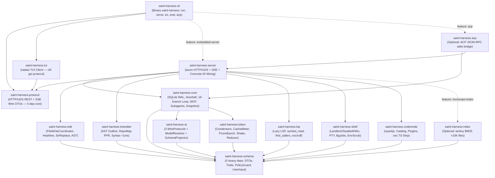

# Master Implementation Plan — `SaintHarness` (Pure Rust Coding Agent Harness)

> **Tài liệu đặc tả gốc:** [pure-rust-harness-plan.md](./pure-rust-harness-plan.md)
> **Workspace triển khai:** `/media/Work/Loco/SaintHarness`
> **Đích tích hợp hệ sinh thái:** `/media/Work/Loco/saint-hyper-agent` (`Saint Hyper Agent`)
> **Môi trường phát triển đã kiểm chứng:** Linux `7.3.4+deb13-amd64` (Debian 13, hỗ trợ Landlock ABI V3+), 12 vCPU, 15 GiB RAM (~6.4 GiB khả dụng), `rustc 1.100.0` / `cargo 1.100.0` tại `$HOME/.cargo/bin` (hỗ trợ Rust Edition 2024), `gcc`/`g++`/`cmake`/`pkg-config` sẵn có; chưa cài `clang`, `mold`, `cargo-nextest`, `ruff`, `rg`.

---

## Phần 1 — Chuẩn hóa Định danh `SaintHarness` & 8 Luật Thép

Để chuyển hóa bản đặc tả `rust-harness` trong [pure-rust-harness-plan.md](./pure-rust-harness-plan.md) thành sản phẩm mang thương hiệu **SaintHarness** đạt chuẩn Clean-Room (Luật #7) và sẵn sàng tích hợp vào **Saint Hyper Agent**, toàn bộ workspace áp dụng bảng định danh thống nhất duy nhất sau:

| Thành phần | Tên trong bản gốc | Chuẩn chính thức `SaintHarness` | Ghi chú kỹ thuật |
|---|---|---|---|
| Tên dự án / Repo | `rust-harness` | `SaintHarness` | Workspace root `Cargo.toml` |
| Tiền tố Crate | `harness-*` | `saint-harness-*` | 13 crates lõi + 1 crate tùy chọn `saint-harness-acp` |
| Binary CLI chính | `harness` | `saint-harness` | Tuyệt đối không đặt alias `sh` (đụng `/bin/sh`) |
| Thư mục cấu hình | `.harness/` (`~/.harness/`) | `.saint-harness/` (`~/.saint-harness/`) | Dùng chung cho `skills/`, `plugins/`, `profiles/`, `routes.toml` |
| Thư mục dữ liệu/spill | `<data>/` | XDG `$XDG_DATA_HOME/saint-harness/` | Chứa SQLite DB, `shell/*.out.zst`, `snapshot/`, `index/` |
| Biến môi trường | `HARNESS_*` | `SAINT_HARNESS_*` | `SAINT_HARNESS_CLAUDE_MODEL`, `SAINT_HARNESS_GEMINI_MODEL`, `SAINT_HARNESS_QWEN38_MODEL`, `SAINT_HARNESS_QWEN4_MODEL`, `SAINT_HARNESS_LOCAL_API_KEY`, `SAINT_HARNESS_HOME` |
| Tệp hướng dẫn dự án | `AGENTS.md` | `AGENTS.md` | Giữ nguyên chuẩn mở Clean-Room |
| HTTP/UDS Protocol | `harness-protocol` | `saint-harness-protocol` | Zero dependency vào `saint-harness-core` |

### 8 Luật Thép (Bắt buộc cưỡng chế bằng CI/Tests ở mọi Task)

1. **Dependency Firewall tuyệt đối:** Kiểm tra tự động qua `scripts/check-firewall.sh` (`cargo tree`):
   - `saint-harness-tui` (và `saint-harness-cli --no-default-features --features tui`) có **0 phụ thuộc** vào `saint-harness-core` hay `saint-harness-server`.
   - `saint-harness-core` có **0 phụ thuộc trực tiếp** vào `tree-sitter`, `ratatui`, `rquickjs`, `tantivy`, `ast-grep-core`, `oxc_*` (toàn bộ 6 crate lá nặng chỉ tiêm qua `Arc<dyn Trait>` định nghĩa trong `saint-harness-schema`).
2. **Dynamic Dispatch & 0 Hardcode Model Version:** Dùng `Arc<dyn Trait>` thay vì generic lồng nhau. Cấm tuyệt đối hardcode số đời Claude/Gemini hay chuỗi ngày beta trong `.rs`. Mọi model ID được giải phân giải động qua `ModelResolver` (`catalog.rs` + `profiles/*.toml` + `SAINT_HARNESS_*_MODEL`).
3. **Byte-Exact Prefix Determinism:** Bắt buộc qua hàm `canonicalize_json()` đệ quy (xem Bẫy #1 bên dưới) + sort `tools[]` theo `name` + cấm timestamp giờ/phút/giây hay `git status` trong `system[]`.
4. **Error Hygiene & Bất biến `UserDeclined`:** Bật `unwrap_used = "deny"`, `expect_used = "deny"`, `panic = "deny"` ở cấp `[workspace.lints.clippy]` (chỉ mở lại trong `#[cfg(test)]`). `ToolOutcome::UserDeclined` tách biệt hoàn toàn với `ToolOutcome::RecoverableError` — không bao giờ biến từ chối trần của người dùng thành tool error gửi lại LLM.
5. **Single SQLite WAL Writer Thread:** Mọi thao tác ghi SQLite đi qua 1 `std::thread` chuyên dụng nhận `WriteCmd` qua bounded `mpsc`, mở `TransactionBehavior::Immediate`, chạy Event + Projector + Commit Hook trong cùng 1 transaction, và **chỉ broadcast SSE sau khi `commit()` thành công**.
6. **Zero Built-in Content Censorship:** Mặc định dùng `NoopPolicyGuard` (trả `GuardDecision::Pass` 100%). Cấm chèn prompt kiểm duyệt đạo đức/chủ đề thương mại vào `prompts/*.txt`. Tầng `saint-harness-ai` xử lý trung lập HTTP 200 `stop_reason: "refusal"` của Anthropic và mở `safety_settings` TOML cho Gemini.
7. **Clean-Room tuyệt đối trong mã nguồn `SaintHarness`:** Cấm tuyệt đối nhắc tên, trích dẫn, đặt comment/docstring, đường dẫn cấu hình, prompt, test hay commit message theo bất kỳ dự án/agent/harness bên ngoài nào trong `crates/`, `profiles/`, `prompts/`, `tests/`. Cưỡng chế tự động bằng `scripts/check-cleanroom.sh`.
8. **Test-First & Zero Warnings theo từng Task:** Mỗi Task `T00`–`T37` chỉ được đánh dấu hoàn thành khi `cargo nextest run -p <crate>` (test offline bằng cassette/mock) xanh 100%, `cargo clippy --workspace --all-targets -- -D warnings` sạch 0 cảnh báo, và cả 2 gate `check-firewall.sh` + `check-cleanroom.sh` pass.

---

## Phần 2 — Kiểm toán 10 Bẫy Kỹ thuật Ẩn trong Bản Đặc tả Gốc & Giải pháp Chốt Cứng

Kiểm toán sâu [pure-rust-harness-plan.md](./pure-rust-harness-plan.md) phát hiện **10 điểm rủi ro thực chiến** có thể gây lỗi biên dịch, deadlock runtime, vỡ Prompt Cache, hoặc khó tích hợp. Toàn bộ 10 giải pháp sau **bắt buộc áp dụng ngay từ đầu**:

| # | Rủi ro phát hiện | Hậu quả nếu bỏ qua | Giải pháp bắt buộc trong `SaintHarness` |
|---|---|---|---|
| **1** | **`serde_json` feature `preserve_order` xung đột ngầm với Luật #3** | `preserve_order` đổi `serde_json::Map` từ `BTreeMap` sang `IndexMap` (giữ thứ tự chèn). Mọi `serde_json::json!({...})` hoặc schema từ MCP sẽ có thứ tự key không đồng nhất → **phá Prompt Cache dù dùng `BTreeMap` ở tầng ngoài!** | Viết hàm `canonicalize_json(Value) -> Value` đệ quy trong `saint-harness-ai::canonical` (sort mọi `Value::Object` theo key alphabet trước khi serialize); không bật `preserve_order` ở tầng wire; khóa bằng unit test `blake3` trên 100 hoán vị key ngẫu nhiên. |
| **2** | **`Landlock` + `Command::pre_exec` Async-Signal-Safety Deadlock** | `pre_exec` chạy giữa `fork()` và `exec()` trong process Tokio đa luồng. Gọi `PathFd::new()` hay tạo `Ruleset` (có heap allocation) bên trong `pre_exec` có thể **deadlock vĩnh viễn trên allocator mutex**! | Ở `saint-harness-shell` (`T16`): mở mọi `PathFd` (`O_CLOEXEC`) và dựng hoàn chỉnh `RulesetCreated` ở **parent process trước `spawn()`**; bên trong `unsafe { cmd.pre_exec(...) }` **chỉ gọi duy nhất `ruleset_created.restrict_self()`** (syscall thuần `prctl` + `landlock_restrict_self`, 0 heap allocation). |
| **3** | **Máy local chưa cài `clang`, `mold`, `cargo-nextest`, `ruff`** | Ghi cứng `linker = "clang"` + `-fuse-ld=mold` vào `.cargo/config.toml` ở `T01` sẽ làm `cargo check` **fail ngay lập tức**. | Bổ sung Task **T00 (Pre-flight)**: chuẩn hóa `export PATH="$HOME/.cargo/bin:$PATH"`, cài `cargo-nextest` (và `clang`/`mold` nếu môi trường cho phép), giữ `.cargo/config.toml.mold` tùy chọn để không gãy máy/CI chưa có `mold`. |
| **4** | **Xung đột ABI `tree-sitter` ↔ `ast-grep-core` ↔ `tree-sitter-*` grammars** | `ast-grep-core` và các grammar crates khóa chặt vào cùng 1 minor `tree-sitter` ABI (0.24 vs 0.25). Lệch phiên bản gây lỗi kiểu `Language` hoặc biên dịch trùng 2 C runtime. | Chốt cứng 1 bộ phiên bản tương thích đồng nhất (`tree-sitter` + `ast-grep-core` + `tree-sitter-*`) ngay tại **T01**; xác minh bằng `cargo tree -d` không có 2 phiên bản `tree-sitter` trong `Cargo.lock`. |
| **5** | **Thiếu các crate con của `oxc` trong `[workspace.dependencies]`** | Bản gốc chỉ liệt kê `oxc_parser`, `oxc_allocator`, `oxc_transformer`, nhưng `T35` cần `oxc_linter` (fast lint JS/TS) và strip `.ts` cần thêm `oxc_span`, `oxc_ast`, `oxc_semantic`, `oxc_codegen`. | Pin đồng bộ trọn bộ `oxc_*` cùng 1 release train trong `Cargo.toml` root, cô lập sau feature `fast-lint` và `ts-plugins` để giữ build cơ bản gọn nhẹ. |
| **6** | **4 file `profiles/*.toml` có trường dị biệt** | `qwen-3.8-27b.toml` dùng `soft_shake_tokens = 62000` và có `[sampling]`; 3 profile còn lại dùng `soft_shake_ratio` và không có `[sampling]`; `[reasoning]`/`[tools]` có field riêng từng provider. | Thiết kế 1 struct `ModelProfile` chuẩn duy nhất với `#[serde(deny_unknown_fields)]`, `soft_shake_tokens: Option<u64>` + `soft_shake_ratio: Option<f64>` (validator buộc có ít nhất 1), `sampling: Option<SamplingSpec>`, `#[serde(default)]` cho cờ tùy chọn. |
| **7** | **SQLite `session_message` thiếu duyệt DAG `/tree` & thiếu trạng thái bền cho `read_diff` / `background_job`** | Truy vấn bằng `ORDER BY seq` sẽ trộn lẫn nhánh `/tree`! `read_diff` (`T14`) và `<background-work>` (`T16`/`T22`) sẽ mất dữ liệu sau restart. | (a) `to_llm_messages` bắt buộc duyệt ngược `parent_msg_id` từ `session.active_branch` (lọc `seq <= revert_staged_seq` nếu đang staged revert); (b) Bổ sung 2 bảng nhẹ vào `0001_init.sql`: `session_file_read_state` và `background_job` + indexes. |
| **8** | **Rò rỉ Bearer Token / API Key vào SQLite hoặc Subprocess Shell** | Lưu cấu hình `mcp_servers` (chứa `Authorization: Bearer ...`) vào bảng `event`/`session` sẽ lộ token trên đĩa; shell subprocess mặc định kế thừa env chứa API keys. | `McpServerSpec` chứa header bí mật chỉ tồn tại **trong RAM** (`SecretString` redact `Debug`/`Display`, `#[serde(skip_serializing)]`); `saint-harness-shell` tự động **scrub** `SAINT_AGENT_GATEWAY_*`, `*_API_KEY`, `*_TOKEN`, `*_SECRET*` khỏi env child process trừ allowlist. |
| **9** | **Khoảng trống Cross-Platform (Windows) & Host Surface (`ask_user`, `additional_directories`, `direct` MCP)** | Bản gốc chỉ có Landlock + Seatbelt + UDS, thiếu tool `ask_user` elicitation và thiếu chế độ `direct` cho MCP server tin cậy (`saint`). | (a) Bổ sung `sandbox_windows.rs` (`#[cfg(target_os = "windows")]`) + TCP loopback kèm ephemeral bearer token (song song UDS); (b) Bổ sung tool `ask_user` + `UserInputRequest`/`Reply`; (c) Hỗ trợ `additional_directories` trong Permission & Landlock; (d) Hỗ trợ per-MCP-server `McpExposure::{Direct, CodeMode, Deferred}` + `auto_approve_servers`. |
| **10** | **`rquickjs` Async Bridge & Bảo vệ RAM 15 GiB khi build song song** | (a) `rquickjs` `AsyncContext` không `Send` qua `.await`; (b) Chạy 6 worktree build Rust nặng (`gix`, `tantivy`, `oxc`, `tree-sitter`, `rquickjs`) song song trên máy 15 GiB RAM (6.4 GiB free) dễ kích OOM killer. | (a) Chạy mỗi JS execution trên 1 dedicated `LocalSet` với `AsyncRuntime`, `set_memory_limit(64 MiB)`, `set_interrupt_handler(Arc<AtomicBool>)` + timer Tokio; (b) Giới hạn song song **2–3 luồng biên dịch đồng thời** với `CARGO_BUILD_JOBS=4`. |

---

## Phần 3 — Kiến trúc Workspace (13 Crates Lõi + 1 Crate ACP Tùy Chọn) & DDL Hoàn thiện

### A. Sơ đồ Dependency Firewall



**Lưu ý kiến trúc:** `saint-harness-core` chỉ phụ thuộc `saint-harness-schema`, `saint-harness-ai`, `saint-harness-token`. Toàn bộ 6 crate lá nặng (`edit`, `treesitter`, `lsp`, `shell`, `codemode`, `index`) chỉ được kết nối ở composition root (`saint-harness-server` / `saint-harness-cli`) thông qua `Arc<dyn Trait>`. Sửa logic trong `saint-harness-core` không kéo rebuild `tree-sitter`/`rquickjs`/`oxc`/`tantivy`.

### B. Feature Flags & Workspace Lints (`Cargo.toml` root)

- `[workspace.package]`: `version = "0.1.0"`, `edition = "2024"`, `rust-version = "1.85"`.
- `[workspace.lints.clippy]`: `unwrap_used = "deny"`, `expect_used = "deny"`, `panic = "deny"`, `todo = "warn"`, `dbg_macro = "deny"` (chỉ cho phép lại trong test với `#[cfg_attr(test, allow(...))]`).
- `[profile.release]`: `lto = "thin"`, `codegen-units = 1`, `strip = "symbols"`.
- Feature matrix tại `saint-harness-cli`:
  - `default = ["lang-core", "embedded-server", "tui"]`
  - `lang-core` (Rust, TS/TSX, JS, Python, Go, JSON, TOML)
  - `lang-all` (thêm C/C++, Java, Bash, YAML, SQL, HTML/CSS)
  - `fast-lint` (`oxc_linter` + `ruff` wrapper)
  - `ts-plugins` (`oxc_transformer` + `oxc_codegen` cho `.ts` plugins)
  - `monorepo-index` (`saint-harness-index` + `tantivy`)
  - `snapcompact` (`tiny-skia` + `png`)
  - `acp` (`saint-harness-acp` subcommand `saint-harness acp`)
  - `full = ["default", "fast-lint", "ts-plugins", "monorepo-index", "acp"]`

### C. Bổ sung Bắt buộc vào `0001_init.sql` (Ngoài 10 bảng đã có ở Phần 3C của `pure-rust-harness-plan.md`)

```sql
-- 1. Lưu trạng thái đọc file bền vững cho Delta Re-Read (read_diff, T14)
CREATE TABLE session_file_read_state (
    session_id      TEXT NOT NULL REFERENCES session(id) ON DELETE CASCADE,
    canonical_path  TEXT NOT NULL,
    last_blake3     TEXT NOT NULL,
    last_line_count INTEGER NOT NULL,
    snapshot_zst    BLOB,                 -- Bản nén zstd (chỉ lưu cho file <= 1 MiB) để tính diff
    read_epoch      INTEGER NOT NULL,     -- Reset khi compaction advanceEpoch()
    updated_at      INTEGER NOT NULL,
    PRIMARY KEY (session_id, canonical_path)
);

-- 2. Theo dõi Background Shell/Subagent Jobs cho <background-work> khi Compaction/Recovery (T16/T22)
CREATE TABLE background_job (
    id              TEXT PRIMARY KEY,
    session_id      TEXT NOT NULL REFERENCES session(id) ON DELETE CASCADE,
    kind            TEXT NOT NULL,        -- shell | subagent
    command_preview TEXT NOT NULL,
    status          TEXT NOT NULL,        -- running | completed | failed | killed | orphaned
    exit_code       INTEGER,
    spill_path      TEXT,
    started_at      INTEGER NOT NULL,
    ended_at        INTEGER
);
CREATE INDEX idx_bg_job_session_status ON background_job(session_id, status);

-- 3. Indexes hiệu năng cho Boot Recovery, /tree DAG & Eval Telemetry
CREATE INDEX idx_subagent_outbox_pending ON subagent_outbox(delivered, created_at);
CREATE INDEX idx_step_metrics_session_step ON step_metrics(session_id, step_num);
CREATE INDEX idx_msg_parent ON session_message(session_id, parent_msg_id);
```

---

## Phần 4 — Kế hoạch Triển khai Chi tiết: 12 Milestones · 38 Atomic Tasks (`T00` → `T37`)

> **Quy tắc giao việc cho Coding Agents / Saint Hyper Agent:**
> - Mọi lệnh Rust phải chạy với `export PATH="$HOME/.cargo/bin:$PATH"` và `CARGO_BUILD_JOBS=4`.
> - Tham chiếu song song các hằng số & thuật toán chi tiết ở Phần 3–4 của [pure-rust-harness-plan.md](./pure-rust-harness-plan.md).
> - Mỗi Task chỉ được sửa các file thuộc phạm vi của Task (không đụng crate ngoài phạm vi trừ khi cập nhật trait/field còn thiếu ở `saint-harness-schema`).

### Milestone M0 — Pre-flight, Workspace Foundation & SQLite Event Store

- **T00 · Environment Pre-flight & Quality Gates**
  - *Files:* `scripts/check-firewall.sh`, `scripts/check-cleanroom.sh`, `scripts/setup-dev.sh`, `Makefile`, `.cargo/config.toml.mold`, `.gitignore`.
  - *Spec:*
    1. Chuẩn hóa môi trường Rust (`export PATH="$HOME/.cargo/bin:$PATH"`), cài đặt `cargo-nextest` (và kiểm tra `clang`/`mold` tùy chọn; không ép `mold` mặc định trong `.cargo/config.toml`).
    2. `scripts/check-firewall.sh`: kiểm tra `cargo tree -p saint-harness-tui` không chứa `saint-harness-core`/`saint-harness-server`; `cargo tree -p saint-harness-core` không chứa `tree-sitter`/`ratatui`/`rquickjs`/`tantivy`/`ast-grep-core`/`oxc_parser`.
    3. `scripts/check-cleanroom.sh`: kiểm tra 0 chuỗi dự án/agent tham khảo bên ngoài và 0 chuỗi hardcode phiên bản Claude/Gemini trong `crates/`, `profiles/`, `prompts/`.
  - *Verify:* `./scripts/check-cleanroom.sh` pass, `rustc --version` ≥ 1.85, `cargo nextest --version` chạy thành công.

- **T01 · Cargo Workspace 14-Crate Skeleton, Dependency Pinning & Static Assets** *(Depends: T00)*
  - *Files:* `Cargo.toml`, 14 `crates/saint-harness-*/Cargo.toml` + `src/lib.rs`, `profiles/{qwen-3.8-27b,qwen-4-upcoming,claude-flagship,gemini-flagship,routes}.toml`, `prompts/{base,qwen-3.8,qwen-4,claude,gemini,compaction}.txt`.
  - *Spec:*
    - Cập nhật toàn bộ env vars sang `SAINT_HARNESS_*`, thư mục sang `.saint-harness/`, tên crate sang `saint-harness-*`.
    - Khóa đồng bộ phiên bản `tree-sitter` ↔ `ast-grep-core` ↔ grammars và trọn bộ `oxc_*` cùng release train.
    - Nhúng `profiles/*.toml` và `prompts/*.txt` qua `include_str!` để binary độc lập chạy không cần file ngoài.
    - Soạn nội dung chuẩn cho 6 file `prompts/*.txt` (`base.txt` ~280 tokens có `${TOOL_GUIDANCE}`, 0 kiểm duyệt chủ đề; `compaction.txt` đủ 7 mục bắt buộc + merge/update + NUDGE).
  - *Verify:* `cargo check --workspace` xanh, `./scripts/check-firewall.sh` pass, `cargo tree -d` không có 2 phiên bản `tree-sitter`.

- **T02 · `saint-harness-schema`: Canonical Contracts, `PolicyGuard`, `UserInput` & Firewall Traits** *(Depends: T01)*
  - *Files:* `crates/saint-harness-schema/src/{lib,message,event,error,tool,permission,agent,guard,ports,mcp}.rs`.
  - *Spec:*
    - `Usage` (saturating arithmetic, `visible_output_tokens()`, `cache_hit_ratio()`).
    - `ContentPart` (`Text`, `Reasoning`, `Media`, `ToolCall`, `ToolResult`, `Compaction`, `EffortMarker`), `Message`, `Role`.
    - `LLMEvent` & `SessionEvent` (`is_durable()` vs `is_ephemeral()`).
    - `AiError` (12 variants đầy đủ), `ToolFailure`, `ToolOutcome::{Completed, RecoverableError, UserDeclined}`.
    - `PermissionEffect` (`Allow < Ask < Deny`, `Ord`), `PermissionRule`, `PermissionPolicy`, `PermissionRequest`, `PermissionReply::{Once, Always(String), Reject, RejectWithFeedback(String)}`.
    - `UserInputRequest` / `UserInputQuestion` / `UserInputAnswers` (phục vụ tool `ask_user` & tích hợp Saint Hyper Agent `respondToUserInput`).
    - `McpServerSpec` (`Stdio` / `StreamableHttp` với `SecretString` redacted + `McpExposure::{Direct, CodeMode, Deferred}` + `auto_approve: bool`).
    - `ModelProfile` & `RoutesConfig` với `#[serde(deny_unknown_fields)]` hỗ trợ cả `soft_shake_tokens` và `soft_shake_ratio`, `AutoOrU64`, `ModelSelector`, `SamplingSpec` optional.
    - `trait PolicyGuard` + `NoopPolicyGuard`.
    - Firewall ports trong `ports.rs`: `WireProtocol`, `EditStrategy`, `FileWritePort`, `CodeOutliner`, `RepoMapper`, `LspPort`, `FastLintPort`, `ScriptHost`, `SandboxRunner`, `SnapshotEngine`, `MonorepoIndex`.
  - *Verify:* `cargo nextest run -p saint-harness-schema` — deserialize thật cả 5 file `profiles/*.toml` với `deny_unknown_fields`, round-trip serde JSON, `Usage` saturating, `PermissionEffect::max()`, `NoopPolicyGuard`, `SecretString` không lộ giá trị trong `Debug`/`Display`.

- **T03 · SQLite WAL Event Store, Single Writer Thread & Deterministic Projector** *(Depends: T02)*
  - *Files:* `crates/saint-harness-core/src/store/{mod,writer,bus,projector,queries}.rs`, `migrations/0001_init.sql`.
  - *Spec:*
    - Migration idempotent với `PRAGMA journal_mode=WAL; PRAGMA foreign_keys=ON; PRAGMA synchronous=NORMAL; PRAGMA busy_timeout=5000;`.
    - 1 `std::thread` chuyên dụng (`sh-sqlite-writer`) nhận `WriteCmd` qua bounded `mpsc` + `oneshot::Sender<Result<CommitReceipt>>`.
    - Mỗi `publish_durable()` mở `TransactionBehavior::Immediate`, tăng `event_sequence`, chèn `event`, gọi `Projector::apply(&tx, &ev)` đồng bộ (cập nhật toàn bộ bảng projection + `session_fts`), chạy commit hook tùy chọn, rồi `tx.commit()` — **chỉ sau commit mới phát `broadcast`**.
    - Ephemeral events (`TextDelta`, `ReasoningDelta`, `ToolProgress`) đi thẳng `broadcast` (gom lô 100ms), không chạm SQLite.
    - Reader pool read-only tách biệt cho truy vấn song song.
  - *Verify:* Stress test 32 Tokio tasks ghi đồng thời 1.000 events vào cùng session → 0 `SQLITE_BUSY`, `seq` liên tục 1..1000 không hổng, replay từ `event` tái tạo 100% bảng projection, FTS5 search khớp.

---

### Milestone M1 — Tri-Model LLM Layer `saint-harness-ai` `[T05, T06, T07 PARALLEL]`

- **T04 · `canonicalize_json`, `SchemaProjector`, `AiError` Classifier, `CachePolicy` & Dynamic `ModelResolver`** *(Depends: T02)*
  - *Files:* `crates/saint-harness-ai/src/{lib,client,canonical,schema_projector,cache_policy,error_classifier,catalog}.rs`.
  - *Spec:*
    - `prepare_request()` pipeline: (1) sanitize unpaired UTF-16 surrogates; (2) sort `tools[]` theo `name` tăng dần; (3) `SchemaProjector` chuẩn Gemini (inline `$defs`/`$ref`, flatten `allOf`, xóa `additionalProperties`/`$schema`/`default`, chống cycle max-depth 16); (4) `canonicalize_json()` đệ quy sort mọi object key; (5) áp `CachePolicy` (`AnthropicInline4` max 4 breakpoints, `QwenSystemTail`, `ImplicitPrefix`, `GeminiImplicit`).
    - `ErrorClassifier` đúng 10 tầng ưu tiên (~40 regex overflow + danh sách loại trừ throttle/TPM/RPM; tôn trọng `x-should-retry` và `Retry-After` kẹp trần `15m`).
    - `ModelResolver` trong `catalog.rs`: thứ tự ưu tiên (1) `--model` CLI → (2) env `profile.model.env_override` → (3) truy vấn `models_endpoint` có ETag/cache đĩa TTL 30m (xếp hạng động cho `latest_flagship` / `latest_fast` / `latest_family:<prefix>`, **0 hardcode số đời Claude/Gemini**) → (4) embedded fallback metadata.
  - *Verify:* ≥ 25 unit tests: 100 hoán vị JSON cùng 1 `blake3` hash, đủ 10 tầng error classifier, schema phức tạp `$ref`/`allOf`/cycle, `Inline4` ≤ 4 breakpoints, `ModelResolver` chọn đúng model mới khi feed `/models` giả lập đời tương lai.

- **T05 `[PARALLEL]` · Protocol 1: `OpenAIChatCompat` (Qwen 3.8 27B & Qwen 4) + `qwen_guard.rs`** *(Depends: T04)*
  - *Files:* `crates/saint-harness-ai/src/protocols/{openai_chat,qwen_guard}.rs`.
  - *Spec:*
    - SSE parser hỗ trợ chunk cắt giữa UTF-8, `reasoning_content` lẫn `<think>...</think>` trong `delta.content`, `stream_options.include_usage = true`, `chat_template_kwargs` (`enable_thinking`, `preserve_thinking`).
    - `qwen_guard.rs`: `thinking-only-guard` cứu `<tool_call>` / `<function=name><parameter=k>v</parameter></function>` kẹt trong `<think>`; sửa JSON code fence & trailing comma; sinh `tool_call_id` ULID nếu rỗng/trùng; `on_halt()` phát `AiError::IncompleteStream`.
    - `Usage`: `non_cached = prompt_tokens.saturating_sub(cached_tokens)`.
  - *Verify:* 10 cassette tests offline (stream sạch, chunk cắt giữa tiếng Việt/UTF-8, `<tool_call>` trong `<think>`, XML function call, JSON fence bẩn, duplicate tool_call_id, stream đứt đột ngột, usage `cached_tokens`, `smol` mode `enable_thinking=false`).

- **T06 `[PARALLEL]` · Protocol 2: `AnthropicMessages` (Claude Flagship Mới Nhất)** *(Depends: T04)*
  - *Files:* `crates/saint-harness-ai/src/protocols/anthropic.rs`.
  - *Spec:*
    - `/v1/messages` SSE state machine đầy đủ; 0 hardcode version/beta tag trong Rust (đọc từ `ResolvedModel` & `routes.toml`).
    - Tối đa 4 `cache_control: {"type": "ephemeral"}` theo thứ tự: tool cuối → `system[0]` → `system[1]` → tail message cuối.
    - Thinking (`adaptive` + `output_config.effort` hoặc `enabled{budget_tokens}` kẹp `[1024, max_tokens/2]`), replay `signature` & `redacted_thinking`, `prefix_mismatch_behavior: "drop_block"`.
    - Hỗ trợ `defer_loading: true` & server-side `clear_tool_uses`; bắt đúng HTTP 200 `stop_reason: "refusal"` + `stop_details` → `AiError::ContentPolicy`.
    - `Usage`: `input_tokens = input + cache_read + cache_write`.
  - *Verify:* 8 cassette tests offline (adaptive thinking + signature, redacted_thinking, parallel tool_use, kẹp ≤ 4 breakpoints, HTTP 200 refusal, `defer_loading` + `clear_tool_uses`, usage formula).

- **T07 `[PARALLEL]` · Protocol 3: `GeminiGenerateContent` (Gemini Flagship Mới Nhất) + `ExternalStdioProtocol`** *(Depends: T04)*
  - *Files:* `crates/saint-harness-ai/src/protocols/{gemini,external_stdio,mod}.rs`.
  - *Spec:*
    - `:streamGenerateContent?alt=sse` với model ID từ `ModelResolver`.
    - Bảo toàn `thoughtSignature` trên mọi model part; gắn `"skip_thought_signature_validator"` cho tool call không chữ ký đầu tiên; tách lượt `user` mới cho `<system-update>` sau `functionResponse`; không gắn inline cache breakpoint.
    - Serialize `safety_settings` từ `ModelProfile` TOML; `non_cached = promptTokenCount.saturating_sub(cachedContentTokenCount)`.
    - `ExternalStdioProtocol`: escape hatch JSON-Lines stdin/stdout.
  - *Verify:* 7 cassette tests offline (thoughtSignature round-trip, unsigned sentinel, functionResponse split, `safety_settings`, usage saturating, incomplete stream, `ExternalStdioProtocol`).

---

### Milestone M2 — Agent Loop, Concurrency, Handoff & Crash Recovery

- **T08 · `Inbox` (`steer`/`queue`), `SessionRunCoordinator` (Doorbell) & Boot Crash Recovery** *(Depends: T03)*
  - *Files:* `crates/saint-harness-core/src/{inbox,coordinator,recovery}.rs`.
  - *Spec:*
    - Admission idempotent theo `client_msg_id`.
    - `promote_unlocked()` dưới `KeyedMutex(session_id)` trong cùng 1 SQLite tx: steer compaction → steer prompts → 1 queue item (không chen giữa cặp `ToolCall`/`ToolResult`).
    - `SessionRunCoordinator`: `DashMap<SessionId, Arc<Mutex<ExecState>>>` + `pending_wake = widest(prev, scope)` + `CancellationToken` + `interrupt(resume: bool)`.
    - Boot Recovery: quét `claim_owner != NULL`, chặn sau `DEFAULT_MAX_RESUME_ATTEMPTS = 10`, `settle_stale_tool_calls()` đóng tool mồ côi → `interrupted`, đánh `background_job` cũ → `orphaned`.
  - *Verify:* Stress test 50 wake đồng thời sát ranh giới idle (0 tin nhắn rơi), test `steer` chờ đóng cặp tool_use/tool_result, test crash-recovery dọn tool mồ côi & chặn ở lần thứ 11.

- **T09 · `to_llm_messages` (DAG Walk + 4 Bất biến Cross-Model Handoff) & `RequestBuilder`** *(Depends: T04–T07, T03)*
  - *Files:* `crates/saint-harness-core/src/context/{mod,to_llm,request_builder}.rs`.
  - *Spec:*
    - Duyệt ngược chuỗi `parent_msg_id` từ `session.active_branch` (tôn trọng `revert_staged_seq`), áp `context_view_epoch` đóng băng.
    - Thực thi đủ 4 bất biến đổi model (`Qwen ↔ Claude ↔ Gemini`) và cắt assistant lỗi sau tool local cuối đã chạy.
    - `RequestBuilder`: dựng `system[0..1]`, `output_limit = min(requested, max(1024, floor(ctx * 0.99) - measured - ceil(estimated * 1.15)))`, `bound_images` hysteresis (`> 25 MiB` → cắt ảnh cũ nhất tới `≤ 15 MiB`), `affinity = parent_id ?? fork_source_id ?? id`.
  - *Verify:* Matrix test đủ 6 cặp handoff (`Qwen↔Claude↔Gemini`), test DAG `/tree` không lẫn nhánh sibling, test `bound_images` hysteresis, test `output_limit`.

- **T10 · `SessionRunner` (`drain` → `step` → `attempt`) + Bảng Quyết định 16 Nhánh** *(Depends: T08, T09)*
  - *Files:* `crates/saint-harness-core/src/runner/{mod,drain,step,attempt}.rs`.
  - *Spec:*
    - Chạy tool local song song bằng `JoinSet` ngay khi `ToolCall` tới (qua `PolicyGuard` & `PermissionService`); `COOPERATIVE_STOP_TIMEOUT = 5s`; pha commit SQLite bất khả hủy.
    - Thực thi đúng thứ tự ưu tiên 16 nhánh ở Phần 4 bản gốc: `ContextOverflow` trước output → `NeedCompaction` (max 1/step); `Unknown` finish → `IncompleteStream`; retry trước output (`fresh_assistant: false`) vs sau output (`fresh_assistant: true`); `UserDeclined` dừng ngay turn; malformed tool input excerpt ≤ 2048 chars; 3-strike `finish=length`; `max_steps` giữ `tools[]` + `tool_choice="none"`; `needs_continuation = !ends_turn && tool_choice != None && any_local_tool_called_or_settled`.
  - *Verify:* Integration suite với `MockWireProtocol` phủ đủ 16 nhánh quyết định.

- **T11 · 3 Ngân sách Retry Độc lập & Doom-Loop Detector** *(Depends: T10)*
  - *Files:* `crates/saint-harness-core/src/runner/{retry,doom_loop}.rs`.
  - *Spec:*
    - 3 ngân sách: `general` (`2s → 4s → 8s → 10s×7`, ±20% jitter), `network` (DNS/unreachable trừ `ECONNREFUSED`, `2s → cap 30s`, tối đa `1h`), `timeout` (tối đa `3` lần); tôn trọng `x-should-retry` & `Retry-After` (cap `15m`).
    - `DoomLoopDetector`: ring buffer 12 phần tử `(tool_name, blake3(canonical_args))`; trùng 3 lần chèn synthetic warning; trùng 5 lần dừng vòng lặp.
  - *Verify:* Deterministic tests với `tokio::time::pause()` xác nhận chính xác timing, tách ngân sách, và doom-loop.

---

### Milestone M3 — Edit Engine, Tree-sitter, Core Tools & Permission Lattice `[T12, T13 PARALLEL]`

- **T12 `[PARALLEL]` · `saint-harness-edit`: `FileWriteCoordinator` × `Hashline`, `StrReplace` & `replace_symbol`** *(Depends: T02)*
  - *Files:* `crates/saint-harness-edit/src/{lib,coordinator,endings,hashline,str_replace,symbol_edit}.rs`.
  - *Spec:*
    - `FileWriteCoordinator`: `KeyedMutex<PathBuf>` theo canonical path; giữ BOM UTF-8; áp line-ending bằng **`imara-diff` Histogram Diff**; sinh unified diff hỏi quyền 1 lần; ghi nguyên tử (`temp + sync + rename` giữ POSIX mode); chạy formatter + `FastLintPort` + `LspPort`.
    - `Hashline`: `ALPHABET = b"ZPMQVRWSNKTXJBYH"`, FNV-1a 32-bit trên `line.trim()` (neighbor hash với `\x1f`/`\x1e` cho dòng ngắn/ký tự ngoặc), strip `^\d+#[A-Z]{2}\|`, validate 100% anchor (lệch → `StaleAnchorError` kèm ±4 dòng + hash mới), chống overlap, sort bottom-up apply nguyên tử.
    - `StrReplace`: 3 tầng LF-view (`exact` → `unicode_normalize` → `trim_end`) + Hough-voting `missHint` (≤ 12 dòng).
    - `replace_symbol`: tính dải thay thế AST thuần trong RAM đi qua chung `FileWriteCoordinator`.
  - *Verify:* ≥ 25 unit & property tests (CRLF/LF lẫn lộn, BOM, UTF-8/emoji, multi-edit bottom-up, overlap reject, stale anchor ±4, prefix-strip, Hough voting, `replace_symbol`).

- **T13 `[PARALLEL]` · `saint-harness-treesitter`: AST Outline, `RepoMap` (Personalized PageRank) & `<1ms` Syntax Check** *(Depends: T02)*
  - *Files:* `crates/saint-harness-treesitter/src/{lib,grammars,outline,repomap,syntax}.rs`.
  - *Spec:*
    - Feature `lang-core` (Rust, TS/TSX, JS, Python, Go, JSON, TOML) và `lang-all`.
    - `outline()`: xuất khung chữ ký kèm dải dòng + hashline anchor cho file ≥ threshold.
    - `RepoMap`: duyệt repo qua `ignore`, trích đồ thị định nghĩa/tham chiếu symbol, chạy Personalized PageRank, binary-search chọn top symbols trong budget `1K–2K` tokens.
    - `check_syntax()`: phát hiện `ERROR`/`MISSING` trong `< 1ms`.
  - *Verify:* Snapshot tests: Outline giảm ≥ 80% token, `RepoMap` xếp hạng đúng file trung tâm trong 1.500 tokens, `check_syntax()` `< 1ms`.

- **T14 · Core Tools (`read` + Delta Re-Read, `edit`, `write`, `grep`, `glob`, `repo_map`, `ask_user`)** *(Depends: T12, T13, T03)*
  - *Files:* `crates/saint-harness-core/src/tools/{mod,read,edit,write,grep,glob,repo_map,ask_user}.rs`.
  - *Spec:*
    - `read`: streaming chunk, offset âm, quá EOF trả 100 dòng cuối, *"Did you mean?"* qua **`nucleo-matcher`**, AST Outline tự động, **Delta Re-Read (`read_diff`)** tra `session_file_read_state` trả `[Unchanged]` hoặc unified diff gọn; chặn binary NUL (trừ ảnh → `ContentPart::Media`).
    - `grep`/`glob`: nhúng trực tiếp `ignore` + `grep-searcher` + `grep-regex` + `globset` + `memchr`; cửa sổ 160 ký tự quanh match; nhóm theo file; timeout 30s.
    - `ask_user`: phát `SessionEvent::UserInputRequested`, chờ `oneshot` trả lời.
  - *Verify:* Integration tests: `.gitignore`, binary NUL, đọc lại file trả `[Unchanged]` / diff, `nucleo-matcher`, grep file minified JS 50KB.

- **T15 · Permission Policy Lattice, Saved Approvals & Multi-Folder Scope** *(Depends: T03)*
  - *Files:* `crates/saint-harness-core/src/permission/{mod,policy,service,saved}.rs`.
  - *Spec:*
    - `Rules`/`Override`/`Restrict`/`Fallback`, last-match-wins, `Deny > Ask > Allow`, short-circuit deny, `ignore_case` macOS/Windows; hỗ trợ `additional_directories` và `auto_approve_servers`; `is_action_denied()` ẩn tool khỏi catalog.
    - Pending `oneshot` map; `Always(pattern)` lưu `permission_saved` (cấm `.env` → `*`, `sudo *`, `bash -c *`) và tự duyệt hàng loạt pending khớp; `Reject` trần hủy cùng message và trả `ToolOutcome::UserDeclined`; `RejectWithFeedback` trả `RecoverableError`.
    - **3 bậc Runtime Mode khớp 1-1 `RuntimeMode` của Saint Hyper Agent (`orchestration.ts`):** (1) `approval-required` (*Ask for approval*, hỏi quyền mặc định dưới `WorkspaceWrite`), (2) `auto` (*Auto mode*, `--auto`: tự duyệt đọc/sửa/build/test bên trong workspace dưới Landlock `WorkspaceWrite`, chỉ dừng hỏi khi rủi ro/ngoài workspace), (3) `full-access` (*Bypass permissions*, `--bypass-permissions`: bỏ qua 100% hộp thoại quyền + `SandboxProfile::Disabled`, luôn hiện cảnh báo cam `#fe8549`), cộng `PlanMode` (chỉ đọc `ReadOnlyWorkspace`).
  - *Verify:* ≥ 18 unit tests phủ toàn bộ lattice, batch auto-resolve, `UserDeclined`, chặn pattern nguy hiểm, fail-closed.

---

### Milestone M4 — OS Kernel Sandbox Shell & First Headless End-to-End Binary

- **T16 · `saint-harness-shell`: Async-Signal-Safe `Landlock`/Seatbelt/Windows Sandbox + Background Shell** *(Depends: T02, T15)*
  - *Files:* `crates/saint-harness-shell/src/{lib,runner,pty,splitter,env_scrub,sandbox_linux,sandbox_macos,sandbox_windows}.rs`.
  - *Spec:*
    - `SandboxProfile::{ReadOnlyWorkspace, WorkspaceWrite { extra_rw_dirs }, Disabled}`.
    - Linux: chuẩn bị `PathFd` (`O_CLOEXEC`) + `RulesetCreated` ABI V3+ ở parent trước `spawn()`, trong `pre_exec` chỉ gọi `restrict_self()`; `bwrap` tùy chọn.
    - macOS: SBPL `sandbox-exec`; Windows: Job Object + env scrub.
    - `env_scrub.rs`: lọc `SAINT_AGENT_GATEWAY_*`, `*_API_KEY`, `*_TOKEN`, `*_SECRET*` trừ allowlist.
    - Timeout 2m chuyển nền (`background_job` + `<background-result kind="shell">`), `SIGTERM (-pgid) → 3s → SIGKILL`, `portable-pty`, command splitter ~250 LOC + ARITY.
  - *Verify:* Integration test thật trên Linux: `ReadOnlyWorkspace` chặn ghi bằng `EACCES`, `WorkspaceWrite` chặn ghi ngoài workspace, `env_scrub` chặn rò token, timeout-to-background gửi `<background-result>`.

- **T17 · `saint-harness-cli` Headless Runner (`saint-harness run --auto`) — Mốc E2E #1** *(Depends: T10, T14, T16)*
  - *Files:* `crates/saint-harness-cli/src/{main,run,wire}.rs`.
  - *Spec:* Composition root nối `core` với `edit`/`treesitter`/`shell`/`NoopPolicyGuard`; lệnh `saint-harness run --profile ... [--model ...] [--auto] [--sandbox ...] "<prompt>"`, in stream + usage + cache hit ratio + `step_metrics`.
  - *Verify:* **Mốc E2E đầu tiên:** Test `saint-harness run --auto` chống mock HTTP server (Qwen/Claude/Gemini) hoàn thành vòng `repo_map` → `read` → `edit` → `shell cargo test` trên repo fixture thật.

---

### Milestone M5 — Token Engine Layer 1 & Delta Instructions `[T18, T19, T20 PARALLEL]`

- **T18 `[PARALLEL]` · Write-Time Semantic CLI/JSON Condensers + `zstd` Spill** *(Depends: T02)*
  - *Files:* `crates/saint-harness-token/src/{lib,condenser,truncation}.rs`.
  - *Spec:* Mô phỏng `\r`, strip ANSI, gom `[repeated ×N]`, bộ lọc cho `cargo`/`tsc`/`eslint`/`pytest`/`jest`/`vitest`/`git diff`/`git log`/`git status`/`ls -la`/`docker`/`kubectl` + JSON array collapse, bookend grapheme-safe `16 KiB + 16 KiB`, spill file `zstd` 7 ngày.
  - *Verify:* Snapshot tests 8 fixture 5.000 dòng nén 60–95%, giữ 100% lỗi, không vỡ UTF-8 tiếng Việt/emoji.

- **T19 `[PARALLEL]` · `CacheMeter`, `PruneEpoch`, Observation Masking & `Superseded` Dedup** *(Depends: T03)*
  - *Files:* `crates/saint-harness-token/src/{estimator,cache_meter,prune}.rs`.
  - *Spec:* `tiktoken-rs` + Anchor estimator (`measured + ceil(estimated * 1.15)`); `CacheMeter` TTL + break-even; Observation Masking (giữ khung `Reasoning + ToolCall`, che `ToolResult` cũ ngoài 8–10 lượt / 25K–40K đuôi) + `Superseded` dedup tích lũy trong `PendingPruneTracker`, chỉ mở `context_view_epoch + 1` khi `!is_warm()` / chạm `soft_shake` / vượt break-even / compaction.
  - *Verify:* **Prefix Determinism Test:** 4 lượt Warm liên tiếp có `blake3(prefix)` khớp 100%; lượt 5 hết TTL mở `epoch + 1` và mask observations cũ.

- **T20 `[PARALLEL]` · `InstructionState` (`blake3` + `imara-diff`), Lazy Nested `AGENTS.md` & Conditional Rules** *(Depends: T03)*
  - *Files:* `crates/saint-harness-core/src/instructions/{mod,state,discovery,agent,rules}.rs`.
  - *Spec:* 2 khối `system[0]`/`system[1]` (`core/date` chỉ `YYYY-MM-DD`, `core/agent` cuối); watcher `notify` debounce 100ms; sửa `AGENTS.md` gửi unified diff (`imara-diff`) qua `<system-update>` không động `system[1]`; lazy nested `AGENTS.md` + Conditional Rules (`.saint-harness/rules/*.md` với `globs:`); chuyển `build ↔ plan` qua `<system-update>`; `advanceEpoch()` sau compaction.
  - *Verify:* Sửa 1 dòng `AGENTS.md` 5KB tạo delta `< 400 bytes` và `system[1]` bất biến; chuyển `build ↔ plan` giữ `system[0..1]`; `advanceEpoch` gộp sạch delta.

---

### Milestone M6 — Compaction 5 Tầng, Tri-Model Role Routing, `/btw` & `/tree`

- **T21 · `shake` (Tier 1), 5-Level Reducer (`SHRINK_STEPS`) & Opt-in `snapcompact`** *(Depends: T19)*
  - *Files:* `crates/saint-harness-token/src/{shake,reducer,snapcompact}.rs`.
  - *Spec:* `shake` đẩy block nặng ra `local://spill/<id>.zst` (< 55% ceiling dừng ngay); `flatten_and_drop_oldest` 5 cấp (0..4, không bỏ exchange cuối) + `SHRINK_STEPS = [0.85, 0.70, 0.50, 0.35]`; `snapcompact` sau feature flag `snapcompact`.
  - *Verify:* `shake` hạ context < 55%, reducer hội tụ với hội thoại 300K tokens.

- **T22 · Compaction Orchestrator, Background Precompute & Structured Summary 7 Mục** *(Depends: T20, T21)*
  - *Files:* `crates/saint-harness-core/src/compaction/{mod,precompute,summary}.rs`.
  - *Spec:* 5 tầng (`Write-Time → shake → Native Anthropic → snapcompact → Structured Summary 7 mục + NUDGE 1x`); bơm `<recent-context>` 15K–20K + `<subagents>` + `<background-work>`; Background Precompute ở `ceiling - 60K` khi cache Warm (`held_index`, đuôi ≤ 40%, max 2 lỗi); `advanceEpoch()` + tăng `read_epoch`.
  - *Verify:* Mock LLM tests (NUDGE 1x, swap precomputed, hủy khi branch đổi, overflow retry qua `SHRINK_STEPS`).

- **T23 · Tri-Model Role Routing (`primary`/`deep`/`compact`/`vision`/`smol`), `/btw` & `/tree`** *(Depends: T09, T22)*
  - *Files:* `crates/saint-harness-core/src/{routing,sidechat,tree}.rs`.
  - *Spec:* Role Router đọc `[roles]` (`routes.toml`); `/btw` read-only cache-hit ephemeral (0 ghi `session_message`); `/tree` rẽ nhánh & fork tại `through_msg_id` trên `parent_msg_id`.
  - *Verify:* `/btw` giữ `blake3` prefix và 0 ghi DB; `/tree` 2 nhánh độc lập.

---

### Milestone M7 — Embedded LSP Diagnostics & Shadow Git Snapshot/Revert `[T24, T25 PARALLEL]`

- **T24 `[PARALLEL]` · `saint-harness-lsp`: Lazy LSP Diagnostics & Symbol Navigation** *(Depends: T02, T12)*
  - *Files:* `crates/saint-harness-lsp/src/{lib,manager,client,diagnostics,symbols}.rs`.
  - *Spec:* Lazy spawn `rust-analyzer`/`typescript-language-server`/`pyright-langserver`/`gopls`; debounce 150ms / cap 1500ms → tối đa 15 `ERROR`, fallback `treesitter` syntax `< 1ms`; tools `symbol_read` & `find_callers`.
  - *Verify:* Mock JSON-RPC stdio LSP server tests cho diagnostics, `symbol_read`, `find_callers`, hard timeout 1500ms.

- **T25 `[PARALLEL]` · Shadow Git Snapshot & 3-Phase Revert (`stage`/`clear`/`commit`)** *(Depends: T03)*
  - *Files:* `crates/saint-harness-core/src/{snapshot,revert}.rs`.
  - *Spec:* Sau `trait SnapshotEngine`; repo tách riêng `<data>/snapshot/<project_hash>/<session_id>` (không đụng `.git` user, bỏ untracked > 2 MiB); hỗ trợ `disable_internal_git_snapshot: bool`; 3-phase revert (`stage`/`clear`/`commit`).
  - *Verify:* Sửa 3 file qua 2 step → `stage` về step 1 → `clear` khôi phục → `stage` + prompt mới `commit`.

---

### Milestone M8 — Subagents, Skills, MCP & `rquickjs` Code Mode / Plugins

- **T26 · Subagents Nền (Depth=1, Concurrency Cap) + Transactional Outbox** *(Depends: T08, T10)*
  - *Files:* `crates/saint-harness-core/src/subagent/{mod,tool,outbox}.rs`.
  - *Spec:* Context con trống, kế thừa cwd/`additional_directories`/permissions, depth=1, `max_concurrent_subagents`, hỗ trợ `stop_subagent`/`steer_subagent`; ghi `subagent_outbox` trong cùng tx terminal → giao `<background-result kind="subagent">` dạng `steer` + wake cha; reboot replay outbox `delivered = 0`.
  - *Verify:* Spawn 2 con → mô phỏng crash trước deliver → reboot vẫn đánh thức cha giao đủ 2 kết quả đúng 1 lần.

- **T27 · Skills Discovery (`.saint-harness/skills/`) & MCP Client (stdio + StreamableHTTP + OAuth PKCE)** *(Depends: T15, T20)*
  - *Files:* `crates/saint-harness-core/src/skill/{mod,discovery}.rs`, `crates/saint-harness-core/src/mcp/{mod,stdio,http,oauth,router}.rs`.
  - *Spec:* Quét `.saint-harness/skills/` (depth 6, watcher 100ms) + `<available_skills>`; MCP stdio + StreamableHTTP (in-memory bearer + OAuth PKCE lưu file `0600`); 3 chế độ `McpExposure` (`CodeMode` mặc định giữ tool trực tiếp Qwen ≤ 8, `Direct` với tên `mcp__<server>__<tool>` + `server_name` cho gateway tin cậy như `"saint"`, `Deferred` cho Claude Tool Search); hỗ trợ per-session `mcp_servers`.
  - *Verify:* Mock MCP 50 tools ở `CodeMode` (Qwen thấy ≤ 8 tool + `execute`); mock StreamableHTTP ở `Direct` + `auto_approve` không lộ bearer token vào DB/log.

- **T28 · `saint-harness-codemode`: `rquickjs` Code Mode `execute` + User Hook Plugins `*.js`** *(Depends: T15, T27)*
  - *Files:* `crates/saint-harness-codemode/src/{lib,runtime,catalog,plugins}.rs`.
  - *Spec:* Nhúng `rquickjs` (`AsyncRuntime` trên dedicated `LocalSet`, RAM 64 MiB, interrupt timeout `Arc<AtomicBool>`, `max_tool_calls = 50`, 0 FS/Net ngoài host `tools.ns.fn()` đi qua `PermissionService`/`PolicyGuard`); catalog ≤ 2.000 tokens + `tools.search()`; nạp `~/.saint-harness/plugins/*.js` với hot-reload (hooks `tool.execute.before/after`, `permission.evaluate`, `session.context`, `session.idle`, `compaction`).
  - *Verify:* Script JS gọi `tools.fs.glob()`, `while(true){}` bị ngắt sau 2s, OOM array bị chặn ở 64 MiB, plugin `guard.js` chặn `rm -rf /`.

---

### Milestone M9 — Daemon Server, `ratatui` TUI, Eval A/B & V1 Release `[T29, T31 PARALLEL]`

- **T29 `[PARALLEL]` · `saint-harness-protocol` & `saint-harness-server` (`axum` HTTP/UDS + SSE)** *(Depends: T10, T15, T23, T26, T27)*
  - *Files:* `crates/saint-harness-protocol/src/lib.rs`, `crates/saint-harness-server/src/{lib,main,routes,sse,auth}.rs`.
  - *Spec:* Hỗ trợ UDS (`--socket`) + TCP loopback (`127.0.0.1:<port>` + ephemeral bearer token). Bộ endpoints đầy đủ cho cả TUI lẫn Saint Hyper Agent:
    - `GET /health`, `GET /models`, `GET /skills`, `GET /plugins`
    - `POST /sessions` (`cwd`, `additional_directories`, `model_profile`, `interaction_mode`, `sandbox_mode`, `approval_policy`, `disable_internal_git_snapshot`, in-memory `mcp_servers[]`), `GET /sessions`, `GET /sessions/:id`, `DELETE /sessions/:id`
    - `POST /sessions/:id/prompt` (`queue`|`steer`, `attachments`, `model_override`, `interaction_mode`), `interrupt`, `fork` (`through_msg_id`), `rollback` (`stage`/`clear`/`commit`), `compact`, `btw`
    - `POST /sessions/:id/tasks/:task_id/stop`, `POST /sessions/:id/tasks/:task_id/steer`
    - `POST /permissions/:request_id/reply`, `POST /user-inputs/:request_id/reply`
    - `GET /events` & `GET /sessions/:id/events` (SSE monotonic `id:` + `Last-Event-ID` resume + live `turn.diff.updated` & `usage`/`cache_meter`).
  - *Verify:* Integration tests HTTP & UDS: prompt, steer, SSE reconnect `Last-Event-ID`, permission reply, `ask_user` reply, `fork`/`rollback`.

- **T30 · `saint-harness-tui`: `ratatui` TUI Client (Live Cache Meter & Token Savings HUD)** *(Depends: T29)*
  - *Files:* `crates/saint-harness-tui/src/{lib,app,view,permission_modal,user_input_modal}.rs`, `crates/saint-harness-cli/src/tui_cmd.rs`.
  - *Spec:* Chỉ phụ thuộc `saint-harness-protocol`; hiển thị Model, **Cache Meter** (`Warm 4m12s · 86% hit`), tỉ lệ nén, chi phí, modal Permission & `ask_user`, lệnh `/btw`, `/tree`, `/compact`, `/model`, `/undo`.
  - *Verify:* `ratatui::backend::TestBackend` render mọi panel & modal ở 80×24 không panic; `./scripts/check-firewall.sh` pass.

- **T31 `[PARALLEL]` · `saint-harness eval` A/B Benchmark Runner (`--repeat 3`)** *(Depends: T17, T23)*
  - *Files:* `crates/saint-harness-core/src/eval.rs`, `crates/saint-harness-cli/src/eval_cmd.rs`.
  - *Spec:* Chạy benchmark YAML/JSON trong sandbox cô lập với `--repeat 3` qua ma trận `--profile` × `--edit`; tổng hợp `pass@1`, `cost_per_resolved_task`, `cache_hit_ratio`, `prefix_preserved_rate`, `edit_first_try_rate`, `lsp_errors_caught`, `compression_ratio` ra Markdown & JSON.
  - *Verify:* 3 mini-task mẫu với mock server tạo báo cáo Markdown & JSON đầy đủ.

- **T32 · V1 Hardening, Release Binary & Full Eval Baseline** *(Depends: T28, T30, T31)*
  - *Spec:* `cargo build --release -p saint-harness-cli`, kiểm tra binary size & cold start `< 15ms`, pass toàn bộ `cargo nextest run --workspace` + `clippy -D warnings` + `check-firewall.sh` + `check-cleanroom.sh`, lưu baseline tại `benchmarks/v1-baseline.json`.

---

### Milestone M10 — V1.5 Accelerator Pack `[T33–T36 PARALLEL]`

- **T33 `[PARALLEL]` · `ast-grep-core` Structural Search & `ast_edit` Tool** *(Depends: T12, T13)*
  - *Files:* `crates/saint-harness-edit/src/ast_edit.rs`, `crates/saint-harness-core/src/tools/ast_edit.rs`.
  - *Verify:* Refactor 10 file Rust/TS có comment/string trùng tên hàm → chỉ đổi đúng AST node qua `FileWriteCoordinator`.

- **T34 `[PARALLEL]` · `gix` (`gitoxide`) Pure Rust Git Engine** *(Depends: T25)*
  - *Files:* `crates/saint-harness-core/src/git_native.rs`.
  - *Verify:* `GixSnapshotEngine` khớp 100% với `git` CLI trên repo có `.gitignore` lồng nhau và submodule (0 fork process).

- **T35 `[PARALLEL]` · Ultra-Fast Lint (`oxc` + `ruff`) & Zero-Node `.ts` Plugin Stripping** *(Depends: T24, T28)*
  - *Files:* `crates/saint-harness-lsp/src/fast_lint.rs`, `crates/saint-harness-codemode/src/ts_strip.rs`.
  - *Verify:* Lỗi cú pháp `.ts` trả về `< 10ms`; plugin `guard.ts` có đầy đủ type annotation chạy mượt trong `rquickjs` không cần Node/Bun.

- **T36 `[PARALLEL]` · `tantivy` BM25 Monorepo Indexer (> 10K–50K Files)** *(Depends: T02, T14)*
  - *Files:* `crates/saint-harness-index/src/lib.rs` (sau feature `monorepo-index`).
  - *Verify:* Lập chỉ mục 5.000 file `< 1s`, top-10 query `< 15ms`, incremental update chính xác.

---

### Milestone M11 — Saint Hyper Agent Integration Bridge

- **T37 · `saint-harness-acp` (ACP JSON-RPC Stdio Bridge) & Saint Adapter Contract Verification** *(Depends: T29)*
  - *Files:* `crates/saint-harness-acp/src/{lib,jsonrpc,session,events}.rs`, `crates/saint-harness-cli/src/acp_cmd.rs`.
  - *Spec:* Vỏ mỏng ~400 LOC chuyển đổi ACP JSON-RPC 2.0 stdio (`initialize` với `mcpCapabilities.http: true`, `session/new`, `session/load`, `session/prompt`, `session/cancel`, `session/set_config_option`, reverse `session/request_permission`) sang `saint-harness-core`.
  - *Verify:* Conformance test vòng đời ACP đầy đủ kèm HTTP MCP server injection.

---

### Lịch Thực thi 6 Đợt (Tối ưu cho máy 12 Core / 15 GiB RAM)

| Đợt | Tasks | Song song tối đa | Mốc bàn giao |
|---|---|---|---|
| **Đợt 0** | `T00` → `T01` → `T02` | Tuần tự | Workspace xanh, Firewall & Clean-Room CI hoạt động |
| **Đợt 1** | `T03` ‖ `T04` | 2 luồng | SQLite WAL Event Store + `saint-harness-ai` core & `ModelResolver` |
| **Đợt 2** | (`T05` ‖ `T06` ‖ `T07`) → (`T12` ‖ `T13` ‖ `T18`) | 3 luồng/nhóm | 3 Wire Protocols + Edit Engine + Tree-sitter/RepoMap + Condensers |
| **Đợt 3** | (`T08` ‖ `T09` ‖ `T15`) → `T10` → `T11` → (`T14` ‖ `T16` ‖ `T19` ‖ `T20`) → **`T17`** | 2–3 luồng | **Mốc E2E V1 Headless đầu tiên (`saint-harness run --auto`)** |
| **Đợt 4** | (`T21` → `T22` → `T23`) ‖ (`T24` ‖ `T25`) → (`T26` ‖ `T27`) → `T28` → (`T29` ‖ `T31`) → `T30` → **`T32`** | 2–3 luồng | **Bản phát hành V1 hoàn chỉnh (Server + TUI + Eval + Subagents + MCP + rquickjs)** |
| **Đợt 5** | (`T33` ‖ `T34`) → (`T35` ‖ `T36`) → `T37` | 2 luồng | **V1.5 Accelerator Pack + Bridge tích hợp Saint Hyper Agent** |

---

## Phần 5 — Đánh giá & Blueprint Tích hợp vào `Saint Hyper Agent`

### Kết luận

**CÓ — Hoàn toàn đưa vào được (~95% tương thích kiến trúc) và là mảnh ghép chiến lược để trở thành First-Party Pure Rust Engine của `Saint Hyper Agent`.**

- `Saint Hyper Agent` (`/media/Work/Loco/saint-hyper-agent`) hiện kết nối 10 runtime ngoài (`packages/contracts/src/orchestration.ts`), chưa có một engine Rust độc lập tích hợp sẵn.
- Tauri v2 (`apps/desktop-rust/tauri.conf.json`) đã dùng `"externalBin": ["binaries/saint-server"]` — hoàn toàn có thể bundle `binaries/saint-harness` làm **sidecar zero-install** (khởi động `< 15ms`, 0 phụ thuộc Node/Bun/Python).

### Phương án Tích hợp Khuyến nghị: **Native HTTP/UDS+SSE Adapter + Tauri Sidecar (kèm ACP tùy chọn)**

| Contract bên `Saint Hyper Agent` (`apps/server/src/provider/Services/ProviderAdapter.ts`) | Thành phần tương ứng của `SaintHarness` | Độ khớp |
|---|---|---|
| `startSession` + `resumeCursor` + `didResumeSession` | `POST /sessions` + SQLite Event Store `session.id` (`T03`, `T08`) | **1:1** |
| `sendTurn` & `steerTurn` (`supportsTurnSteering: true`) | `POST /sessions/:id/prompt` (`queue` vs `steer`, `T08`, `T29`) | **1:1** |
| `interruptTurn` | `POST /sessions/:id/interrupt` (`CancellationToken` + 5s cooperative stop, `T10`) | **1:1** |
| `respondToRequest` (`accept`/`acceptForSession`/`decline`/`cancel`) | `POST /permissions/:id/reply` (`Once`/`Always`/`Reject` → `UserDeclined`, `T15`) | **1:1** |
| `respondToUserInput` | `POST /user-inputs/:id/reply` + tool `ask_user` (`T02`, `T14`, `T29`) | **1:1** |
| `forkThread` (`supportsForkThroughTurn: true`) | `POST /sessions/:id/fork` trên `/tree` DAG `parent_msg_id` (`T23`) | **1:1** |
| `rollbackThread` (`conversationRollback: "native"`) | `POST /sessions/:id/rollback` (`T25`) + `disable_internal_git_snapshot: true` | **1:1** |
| `compactThread` | `POST /sessions/:id/compact` (Compaction 5 tầng, `T21`–`T22`) | **1:1** |
| `stopTask` / `backgroundTask` / `steerSubagent` | Background shell (`T16`) + Subagent controls (`T26`) | **1:1** |
| `listModels` / `listSkills` / `listPlugins` | `GET /models`, `GET /skills`, `GET /plugins` (`T04`, `T27`, `T28`) | **1:1** |
| `sessionModelSwitch: "in-session"` | Cross-Model Handoff (`Qwen ↔ Claude ↔ Gemini`, `T09`) | **Độc quyền** |
| `fresh-ids-once` + `supportsLiveTurnDiffPatch` + `ThreadTokenUsageSnapshot` | SSE monotonic `seq` + `Last-Event-ID` + `turn.diff.updated` + `step_metrics` | **1:1** |

### 6 Điểm Lưu ý Bắt buộc Khi Nối Vào `Saint Hyper Agent`

1. **Tránh trùng Git Checkpointing:** Truyền `disable_internal_git_snapshot: true` khi `SaintHarnessAdapter` tạo session để nhường Git undo cho `apps/server/src/checkpointing`.
2. **Giữ MCP `"saint"` ở chế độ `Direct`:** Trong `T27`, server `"saint"` gắn `McpExposure::Direct` (hoặc `Deferred` với Claude) + `auto_approve: true` khi `autoApproveSaintTools === true`, tên tool chuẩn `mcp__saint__<tool>` + `server_name: "saint"` để khớp `computerToolPermission.ts` & `harnessPolicy.ts`.
3. **Không lưu Bearer Token ra đĩa & Scrub Shell Env:** `POST /sessions` nhận `mcp_servers[]` chỉ giữ trong RAM; `saint-harness-shell` lọc sạch `SAINT_AGENT_GATEWAY_*` khỏi mọi subprocess.
4. **Phân tách Subagent nội bộ vs Saint Threads:** Subagent của `SaintHarness` map sang `collab_agent_tool_call` cục bộ; tạo Saint thread luôn gọi `saint_create_threads`.
5. **Đa nền tảng (Linux/macOS/Windows):** Dùng TCP loopback + ephemeral bearer token trên Windows (UDS trên Unix) và `sandbox_windows.rs`.
6. **Multi-Account Isolation (`ProviderInstance`):** Cấu hình hoàn toàn qua env (`SAINT_HARNESS_HOME`, API keys) tương thích trực tiếp synthetic HOME của Saint.

### Bản đồ File Cần Chạm Bên `/media/Work/Loco/saint-hyper-agent` (Pha Tích hợp sau M9)

| Layer | File mục tiêu | Việc cần làm |
|---|---|---|
| `packages/contracts` | `src/orchestration.ts`, `src/providerDiscovery.ts`, `src/settings.ts` | Thêm `"saintHarness"` vào `ProviderKind` + schema options (`profile`, `editMode`, `sandboxMode`, `effort`) |
| `packages/shared` | `src/providerInstances.ts` | Metadata mặc định & label cho `saintHarness` |
| `apps/server` | `src/provider/Services/SaintHarnessAdapter.ts`, `src/provider/Layers/SaintHarnessAdapter.ts` | Triển khai `ProviderAdapterShape` kết nối `saint-harness-server` (HTTP/UDS + SSE) |
| `apps/server` | `src/provider/Layers/ProviderAdapterRegistry.ts`, `ProviderHealth.ts`, `ProviderDiscoveryService.ts`, `runtimeLayer.ts` | Đăng ký adapter (pass `assertProviderAdapterConformance`), health probe, model/skill/plugin discovery |
| `apps/server` | `src/agentGateway/harnessPolicy.ts`, `src/agentGateway/mcpInjection.ts` | Thêm `"saintHarness"` vào `PROVIDERS_WITH_THREAD_SCOPED_SAINT_MCP` + `buildSaintHarnessMcpServers()` |
| `apps/web` | Settings Providers UI, Model Picker, Thread Status Bar | Hiển thị provider SaintHarness, chọn profile Qwen/Claude/Gemini, tùy chọn live **Cache Meter** |
| `apps/desktop-rust` *(tùy chọn)* | `tauri.conf.json` + release build script | Bundle `binaries/saint-harness` vào `externalBin` thành sidecar zero-install |
