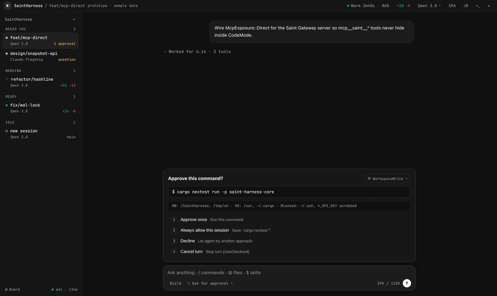
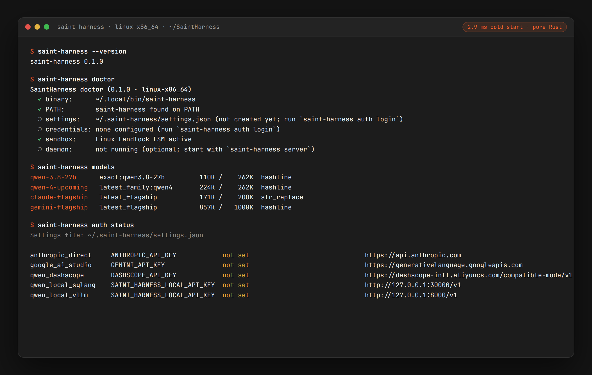
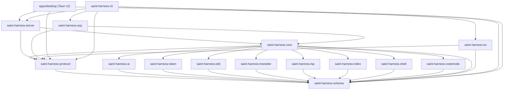

# SaintHarness

**Pure Rust coding agent workspace: native Tauri v2 Desktop App (GUI) as the primary interface, plus a Terminal CLI/TUI client (Beta), crash-safe SQLite WAL engine, and OS-sandboxed tool runner.**

[](https://github.com/Locotine/SaintHarness/releases/latest)
[-orange.svg)](Cargo.toml)
[](RELEASE.md)
[](Cargo.toml)

SaintHarness ships as a **native Tauri v2 Desktop App (`saint-harness-desktop`)** with an in-process embedded Rust agent server (`saint-harness-server`), no terminal required, no Node.js or Python runtime dependencies at runtime, and zero hardcoded provider model versions. A standalone **Terminal CLI & TUI (`saint-harness`)** is also included in **Beta** for headless workflows, daemon hosting, and terminal-first usage.


---

## Surface Status

| Surface | Status | Installers / Binaries (`v0.2.0`) | Notes |
| :--- | :---: | :--- | :--- |
| **Desktop App (GUI)** | **Primary (Recommended)** | Linux x64 (`.deb`), macOS arm64 & x64 (`.dmg`), Windows x64 (`.exe`, `.msi`) | Native Tauri v2 window with embedded Rust server, graphical API Keys dialog, OS folder picker, live Git diff drawer, and Dark/Light themes. |
| **Terminal CLI & TUI** | **Beta** | Linux x64/arm64 (`.tar.gz`, `.deb`), macOS arm64/x64 (`.tar.gz`), Windows x64 (`.zip`) | Interactive `ratatui` TUI (`saint-harness`), headless `run`, HTTP/UDS daemon (`serve`), `auth`, `sessions`, `eval`, `update`. |
| **ACP IDE Bridge** | **Beta** | Included in CLI release builds | JSON-RPC 2.0 stdio bridge (`saint-harness acp`) for external IDE integration. |
| **Package Managers** | **Manifests only** | Attached to GitHub Releases (`saint-harness.rb`, `saint-harness.scoop.json`, `winget-manifests.tar.gz`) | Public Homebrew tap, Scoop bucket, WinGet submission, and npm package are not published yet. Install directly from [GitHub Releases](https://github.com/Locotine/SaintHarness/releases/latest). |

---

## Desktop App Walkthrough (Primary)

Launch **SaintHarness** directly from your OS application launcher without opening a terminal. Configure provider credentials in the built-in **API Keys** dialog (`~/.saint-harness/settings.json`, `chmod 0600`), open any project folder with native OS dialogs, stream live tool execution traces, switch models mid-session, and inspect real `git diff` hunks side by side.

| Graphical API Keys & Connection Test | Live Light Workspace & Split Git Diff |
| :---: | :---: |
|  |  |

---

## Installation (Desktop App, Recommended)

Download the prebuilt installer from [GitHub Releases (`v0.2.0`)](https://github.com/Locotine/SaintHarness/releases/latest). Every release ships with `SHA256SUMS.txt` so you can verify downloads before installing.

### Linux (Debian 12/13 & Ubuntu 22.04/24.04, x64)

```bash
curl -fSLO https://github.com/Locotine/SaintHarness/releases/download/v0.2.0/saint-harness-desktop_0.2.0_amd64.deb
sudo apt install -y ./saint-harness-desktop_0.2.0_amd64.deb
```

Open **SaintHarness** from your application menu or run `saint-harness-desktop`.

### macOS (Apple Silicon & Intel)

- **Apple Silicon (arm64):** download [saint-harness-desktop_0.2.0_aarch64.dmg](https://github.com/Locotine/SaintHarness/releases/download/v0.2.0/saint-harness-desktop_0.2.0_aarch64.dmg)
- **Intel (x64):** download [saint-harness-desktop_0.2.0_x64.dmg](https://github.com/Locotine/SaintHarness/releases/download/v0.2.0/saint-harness-desktop_0.2.0_x64.dmg)

Open the `.dmg` and drag **SaintHarness** into `Applications`.

> **macOS Gatekeeper note:** Current `.dmg` builds are ad-hoc signed (Apple Developer ID notarization is not configured yet). If macOS warns that the app cannot be opened, clear the quarantine attribute once:
> ```bash
> xattr -dr com.apple.quarantine "/Applications/SaintHarness.app"
> ```

### Windows (x64)

- Download and run [saint-harness-desktop_0.2.0_x64-setup.exe](https://github.com/Locotine/SaintHarness/releases/download/v0.2.0/saint-harness-desktop_0.2.0_x64-setup.exe) (NSIS installer) or [saint-harness-desktop_0.2.0_x64.msi](https://github.com/Locotine/SaintHarness/releases/download/v0.2.0/saint-harness-desktop_0.2.0_x64.msi) (MSI package).

### Verify Checksum (Optional)

```bash
curl -fSLO https://github.com/Locotine/SaintHarness/releases/download/v0.2.0/SHA256SUMS.txt
sha256sum -c --ignore-missing SHA256SUMS.txt
```

### Build Desktop App from Source

Requires Rust `1.85+` (Edition 2024) and Node.js `22+` (used only at build time by the Tauri CLI; zero Node.js dependency at runtime):

```bash
# Linux (requires libwebkit2gtk-4.1-dev, libayatana-appindicator3-dev, librsvg2-dev, libssl-dev, patchelf)
make desktop-install   # Builds .deb, installs to ~/.local/bin/saint-harness-desktop, and registers launcher

# macOS (.dmg) or Windows (.exe / .msi)
cd apps/desktop && npm ci && npm run build
```

---

## Quick Start (Desktop App)

1. **Launch SaintHarness** from your OS application menu (`SaintHarness`).
2. **Add an API Key or Local Server:** Click **API Keys** in the top-right bar (or press `Ctrl+,` / `Cmd+,`) and choose one of the 6 built-in presets:
   - **Anthropic (Claude)**
   - **Google AI Studio (Gemini)**
   - **DashScope (Qwen Cloud)**
   - **Local SGLang (`127.0.0.1:30000`)**
   - **Local vLLM / Ollama (`127.0.0.1:8000`)**
   - **OpenAI-Compatible Endpoint** (OpenAI, OpenRouter, LiteLLM, or custom gateways)

   Click **Save** (stored locally in `~/.saint-harness/settings.json` with `0600` permissions on Unix) and **Test Connection** to verify live reachability.
3. **Open a Workspace & Start Coding:** Pick your project folder from the top bar, choose a sandbox access mode (`Ask for approval`, `Auto mode`, or `Bypass permissions`), and send your first prompt.

### Desktop Keyboard Shortcuts & Slash Commands

| Shortcut | Action |
| :--- | :--- |
| `Ctrl+,` / `Cmd+,` | Open **API Keys & Provider Endpoints** settings |
| `Ctrl+B` / `Cmd+B` | Toggle session sidebar |
| `Ctrl+D` / `Cmd+D` | Toggle live Git Diff drawer |
| `Ctrl+G` / `Cmd+G` | Toggle Agent Board overview (`Needs you` / `Working` / `Ready`) |
| `Ctrl+N` / `Cmd+N` | Start a new session in the current workspace |
| `Ctrl+T` / `Cmd+T` | Open Session DAG tree and branch switcher |
| `Ctrl+Alt+S` / `Cmd+Alt+S` | Open `/btw` ephemeral read-only sidechat (no history writes) |
| `Alt+M` | Open cross-model handoff picker |
| `Alt+A` | Open runtime access & sandbox mode popover |
| `Alt+T` | Toggle Dark / Light theme |
| `Shift+Tab` | Toggle `Build` / `Plan` mode |
| `Esc` | Dismiss active palette, modal, or drawer |

Composer slash commands: `/plan`, `/auto`, `/bypass`, `/supervised`, `/diff`, `/btw`, `/tree`, `/board`, `/model`, `/compact`, `/new`, `/settings`, `/theme`.

---

## Local Credentials, Privacy & Core Engine

Both the Desktop App and the Terminal (Beta) client share the same local Rust engine and settings store:

- **Local-Only Credentials:** API keys and custom route overrides live strictly in `~/.saint-harness/settings.json` (`chmod 0600` on Unix), never in SQLite.
- **Settings Precedence (lowest to highest):**
  1. `~/.saint-harness/settings.json` (or `$SAINT_HARNESS_SETTINGS` / `$SAINT_HARNESS_HOME/settings.json`)
  2. `<workspace>/.saint-harness/settings.json` (shared project config; do not commit secrets)
  3. `<workspace>/.saint-harness/settings.local.json` (git-ignored local overrides)
  4. Process environment variables (`ANTHROPIC_API_KEY`, `GEMINI_API_KEY`, `DASHSCOPE_API_KEY`, `OPENAI_API_KEY`, `SAINT_HARNESS_LOCAL_API_KEY`)
- **Direct TLS & Zero Telemetry:** Outbound HTTP uses pure Rust `reqwest` + `rustls-tls` directly to your configured `baseUrl`. No analytics or background phone-home calls. Point `local` / `vllm` at `127.0.0.1` to work completely offline.
- **Crash-Safe SQLite WAL Store:** Dedicated single writer thread (`sh-sqlite-writer`) using `BEGIN IMMEDIATE` transactions with atomic event logging and SSE event streaming.
- **4-Strategy Atomic File Editing:** Hashline (`<line>#<2-char-hash>`) bottom-up patching, unique `str_replace`, `tree-sitter` syntax checks, and `ast-grep` structural rewriting coordinated per file path.
- **OS-Enforced Shell Sandboxing:** Linux Landlock LSM, macOS Seatbelt (`sandbox-exec`), and Windows JobObject / restricted execution with automatic secret scrubbing (`*_API_KEY`, `*_TOKEN`, `*_SECRET`).
- **Dynamic Model Resolution & Prompt Cache Determinism:** Resolves `exact:*`, `latest_family:*`, and `latest_flagship` selectors against live provider model endpoints with canonical `BTreeMap` serialization, `PruneEpoch` deferred masking, and 5-tier context compaction.

Example `~/.saint-harness/settings.json`:

```json
{
  "env": {
    "ANTHROPIC_API_KEY": "sk-ant-...",
    "GEMINI_API_KEY": "AIza..."
  },
  "defaultProfile": "claude-flagship",
  "routes": {
    "qwen_local_sglang": {
      "protocol": "openai_chat_compat",
      "baseUrl": "http://127.0.0.1:30000/v1",
      "modelsEndpoint": "/models",
      "apiKeyEnv": "SAINT_HARNESS_LOCAL_API_KEY"
    }
  }
}
```

---

## Terminal CLI & TUI (Beta)

> **Beta notice:** The terminal interface (`saint-harness` CLI, interactive `ratatui` TUI, `serve` daemon, and `acp` bridge) is under active refinement. For day-to-day interactive coding, start with the **Desktop App (GUI)** above.

### Install Terminal Binary (Beta)

#### macOS, Debian (12/13), and Ubuntu (22.04/24.04)

```bash
curl -fsSL https://github.com/Locotine/SaintHarness/releases/latest/download/install.sh | bash
```

Or install the Debian/Ubuntu `.deb` system-wide (`/usr/bin/saint-harness`):

```bash
curl -fsSL https://github.com/Locotine/SaintHarness/releases/latest/download/install.sh | bash -s -- --deb
```

#### Windows (x64 PowerShell)

```powershell
irm https://github.com/Locotine/SaintHarness/releases/latest/download/install.ps1 | iex
```

#### Build CLI / TUI from Source

```bash
git clone https://github.com/Locotine/SaintHarness.git
cd SaintHarness
make install        # Builds --features full and installs to ~/.local/bin/saint-harness
# or `make release` for the default binary in target/release/saint-harness
```

#### Update, Diagnose, and Uninstall

```bash
saint-harness doctor           # Check binary path, settings.json permissions, OS sandbox, daemon
saint-harness update --check   # Check GitHub Releases without modifying the binary
saint-harness update           # Download, verify SHA-256, and atomically replace the binary

# Uninstall (keeps ~/.saint-harness/ settings and session DBs)
curl -fsSL https://github.com/Locotine/SaintHarness/releases/latest/download/install.sh | bash -s -- --uninstall
```

### Terminal Usage Examples (Beta)

```bash
# Save an API key from the terminal
saint-harness auth login --provider anthropic --set-default
saint-harness auth login --provider local --base-url http://127.0.0.1:30000/v1
saint-harness auth status

# Open interactive TUI (auto-starts an embedded daemon)
saint-harness

# Headless one-shot turn
saint-harness run "Add a unit test for concurrent WAL writers" --auto
saint-harness run "Check workspace setup" --dry-run --json

# Standalone HTTP/UDS + SSE daemon and attached TUI
saint-harness serve --port 3774
saint-harness tui --attach http://127.0.0.1:3774
```

### Terminal Subcommands (Beta)

| Command | Description |
| :--- | :--- |
| `saint-harness` / `tui` | Interactive `ratatui` TUI (`--attach <url>`, `--session <id>`). Extra TUI shortcuts: `Ctrl+J` (CLI output drawer), `1`..`4` (approval cards), `Ctrl+Q` / `Ctrl+C` (exit). |
| `saint-harness run [PROMPT]` | Headless one-shot turn (`-` reads stdin; supports `--mode`, `--runtime-mode`, `--auto`, `--bypass-permissions`, `--sandbox`, `--edit`, `--max-steps`, `--stream-json`, `--dry-run`). |
| `saint-harness auth <subcmd>` | Manage local API keys and routes (`login`, `status`, `logout`, `path`). |
| `saint-harness serve` | HTTP/UDS + SSE daemon (`--host`, `--port`, `--socket`, `--auth-token`, `--idle-exit-ms`). |
| `saint-harness server status` | Inspect daemon reachability, SQLite WAL health, and active session counts. |
| `saint-harness models` | List profiles and resolve dynamic selectors (`--json`). |
| `saint-harness sessions <subcmd>` | Manage SQLite WAL sessions (`list`, `resume`, `fork`, `tree`, `export`). |
| `saint-harness eval <SUITE>` | Run A/B benchmark evaluation matrices (`--profiles`, `--edit`, `--repeat`, `--dry-run`, `--out`). |
| `saint-harness mcp <subcmd>` | Inspect and test configured MCP servers (`list`, `test`). |
| `saint-harness acp` | ACP JSON-RPC 2.0 stdio bridge for external IDEs (built with `--features acp`). |
| `saint-harness update` | Self-updater using `release-manifest.json` and SHA-256 verification (`--check`, `--version`, `--force`). |
| `saint-harness doctor` | Local environment, sandbox, and daemon diagnostics. |

Global flags: `--home-dir <DIR>`, `--profile <PROFILE>`, `--model <MODEL>`, `--theme <auto|saint-dark|saint-light|ansi16>`, `--json`, `--no-color`, `--no-motion`.

<details>
<summary>Terminal TUI & CLI Previews (Beta)</summary>





| Fresh TUI Session Landing (Saint Dark) | CLI Diagnostics (`doctor`, `models`, `auth status`) |
| :---: | :---: |
|  |  |

</details>

---

## Architecture (15 Rust Crates + Tauri v2 Desktop App)

SaintHarness enforces an acyclic dependency firewall (Law #1, checked on every commit by `scripts/check-firewall.sh`). The `saint-harness-tui` crate depends only on `saint-harness-protocol` and `saint-harness-schema`, while `apps/desktop/src-tauri` embeds `saint-harness-server` in-process so the Desktop App needs no external daemon process.



| Crate / App | Responsibility |
| :--- | :--- |
| `apps/desktop` | Native Tauri v2 Desktop App (`saint-harness-desktop`) with embedded Rust server, IPC bridge, and vanilla HTML/CSS/JS UI. |
| `saint-harness-schema` | Shared domain types, routes, model selectors, local `settings.json` store, embedded profiles. |
| `saint-harness-protocol` | Versioned HTTP/UDS REST + SSE contract types shared by server, Desktop App, TUI, and external clients. |
| `saint-harness-ai` | Wire protocol adapters (Anthropic Messages, Gemini GenerateContent, OpenAI-compatible), SSE streaming, dynamic `ModelResolver`. |
| `saint-harness-token` | Prompt cache breakpoint placement, `PruneEpoch`, write-time tool output condenser, 5-tier compaction, optional `snapcompact`. |
| `saint-harness-edit` | 4-strategy atomic editor (Hashline, `str_replace`, tree-sitter check, `ast-grep`) and `FileWriteCoordinator`. |
| `saint-harness-treesitter` | Multi-language outline extraction, repo-map symbol ranking, syntax verification, optional `oxc` fast-lint. |
| `saint-harness-lsp` | Managed LSP lifecycle, diagnostics collection, and edit verification hooks. |
| `saint-harness-index` | Ripgrep-backed search, fuzzy file matching, optional `tantivy` monorepo full-text index. |
| `saint-harness-shell` | Sandboxed process runner (Landlock / Seatbelt / Windows JobObject), PTY sessions, env secret scrubbing. |
| `saint-harness-codemode` | Embedded QuickJS (`rquickjs`) execution sandbox, optional TypeScript stripping (`oxc_transformer`), MCP tool projection. |
| `saint-harness-core` | Single-writer SQLite WAL event store, session DAG branching, `AgentRunner` tool loop, built-in tools, eval harness. |
| `saint-harness-server` | `axum` HTTP/UDS + SSE server with bearer auth and idle auto-exit. |
| `saint-harness-acp` | Agent Client Protocol JSON-RPC 2.0 stdio bridge for external IDEs. |
| `saint-harness-tui` | `ratatui` terminal client (Beta) verified against `prototypes/tui-parity-contract.json` across 5 viewport breakpoints. |
| `saint-harness-cli` | Unified `saint-harness` CLI entrypoint (Beta), local auth UX, `doctor`, and atomic self-updater. |

---

## Optional Cargo Feature Flags

Heavy accelerators are opt-in Cargo features on `saint-harness-cli`:

| Feature | Default | Dependencies | Purpose |
| :--- | :---: | :--- | :--- |
| `lang-core` | Yes | `tree-sitter` (Rust, TS, JS, Python, Go, JSON, TOML) | Syntax validation, outlines, repo-map symbol extraction |
| `embedded-server` | Yes | `saint-harness-server`, `core`, `ai` | Local `run`, `serve`, `sessions`, and `eval` execution |
| `tui` | Yes | `saint-harness-tui`, `ratatui`, `crossterm` | Interactive terminal UI client (Beta) |
| `acp` | Release / Opt-in | `saint-harness-acp` | ACP JSON-RPC 2.0 stdio IDE bridge (Beta) |
| `fast-lint` | Opt-in | `oxc_parser`, `oxc_semantic` (`0.160`) | Sub-millisecond JS/TS static parse and semantic diagnostics |
| `ts-plugins` | Opt-in | `oxc_transformer`, `oxc_codegen` (`0.160`) | Native TypeScript stripping for CodeMode plugins |
| `monorepo-index` | Opt-in | `tantivy` (`0.22`) | Indexed full-text symbol and file search for large monorepos |
| `snapcompact` | Opt-in | `tiny-skia`, `png` | Compact visual transcript snapshots during deep compaction |
| `full` | Opt-in | All features above | Complete CLI/TUI binary with all accelerators enabled |

---

## Development & Quality Gates

Install the git pre-commit hook (runs clean-room checks, Law #1 dependency firewall, and UI parity checks on every commit):

```bash
make hooks
```

Run workspace and Desktop verification locally:

```bash
make all             # CI contracts, cleanroom, firewall, fmt, strict clippy, workspace tests, TUI parity
make desktop-check   # Desktop Rust fmt, clippy (-D warnings), and unit tests
```

For CI lane details, see [.github/CI.md](.github/CI.md). For release engineering and cross-platform packaging, see [RELEASE.md](RELEASE.md).

---

## License

MIT License. See [Cargo.toml](Cargo.toml).
