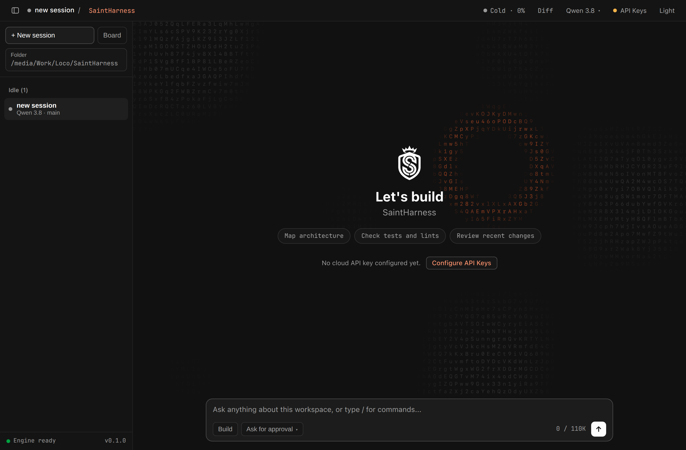
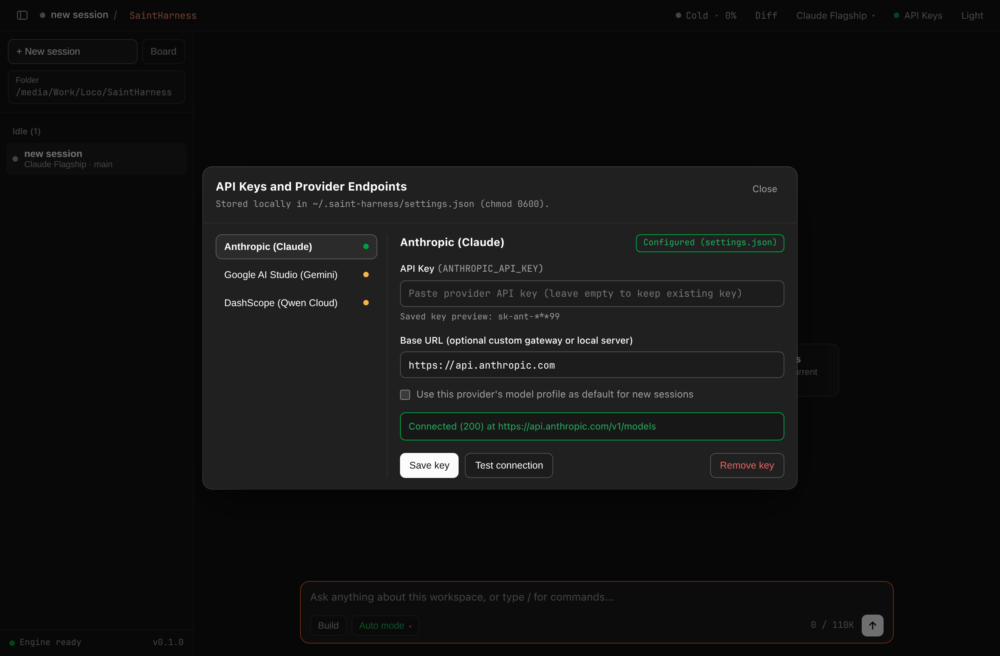
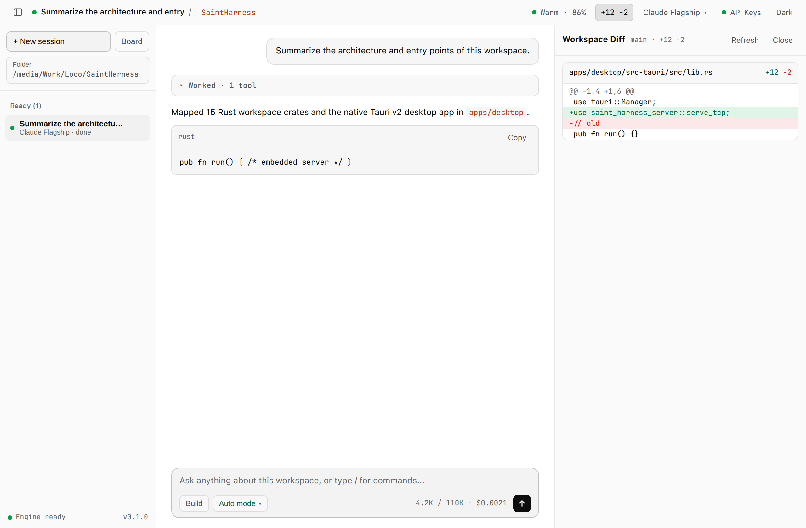
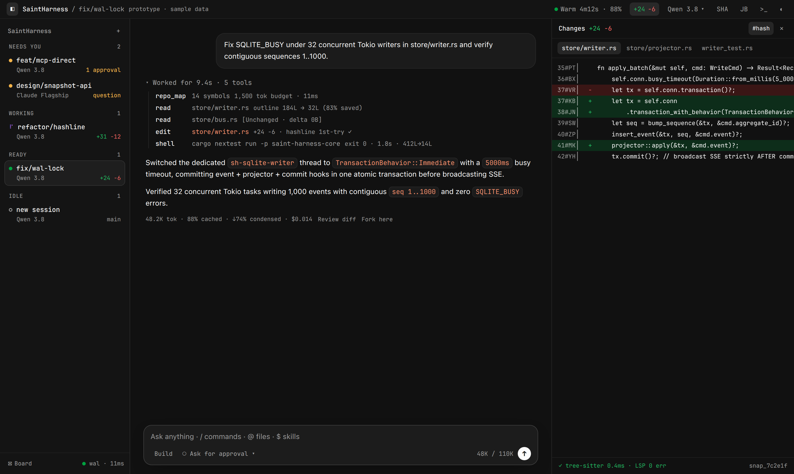
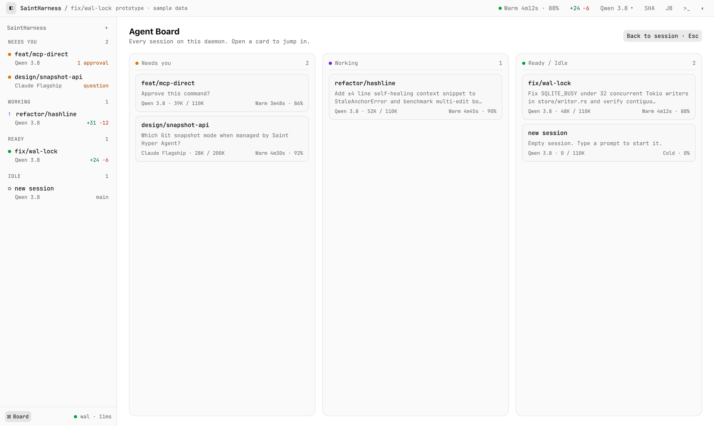
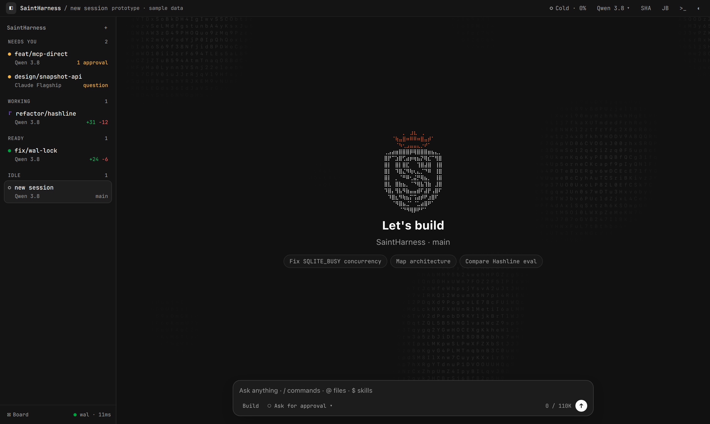
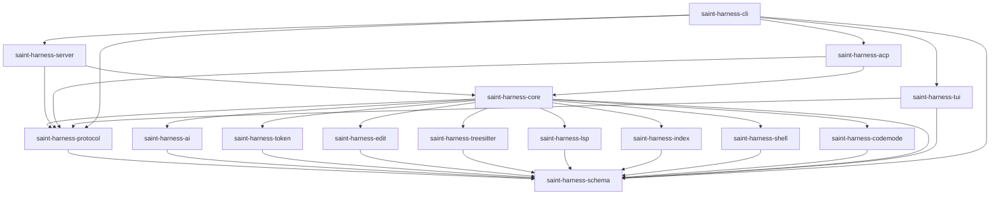

# SaintHarness

**Pure Rust coding agent harness: native Tauri v2 desktop app, interactive terminal UI, SQLite WAL daemon, sandboxed tool runner, and IDE bridge.**

[-orange.svg)](Cargo.toml)
[](RELEASE.md)
[](Cargo.toml)

SaintHarness compiles a 15-crate Rust workspace into both a self-contained CLI/TUI executable (`21 MB` default stripped, `< 5 ms` cold start) and a native **Tauri v2 Desktop App** (`9.8 MB` `.deb`) with an in-process embedded Rust server, zero Node.js or Python runtime dependencies, and zero hardcoded provider model versions.



---

## Key Capabilities

- **Single Native Binary, Sub-5 ms Startup:** Measured `4.7 ms` cold start for the default `21 MB` binary and `2.9 ms` for the `25 MB` full-featured build (`--features full`).
- **Crash-Safe SQLite WAL Event Store:** A single dedicated writer thread (`sh-sqlite-writer`) uses `BEGIN IMMEDIATE` transactions with atomic event persistence, projection updates, and post-commit SSE broadcasts.
- **Byte-Exact Prompt Cache Determinism & 5-Tier Compaction:** Canonical BTreeMap JSON serialization, `PruneEpoch` cache-warm deferred masking, write-time tool output condensation, and five compaction tiers from zero-LLM shake to structured handoff.
- **4-Strategy Atomic File Editing:** Supports Hashline (`<line>#<2-char-hash>`) bottom-up patching with self-healing context snippets, unique `str_replace`, `tree-sitter` structural validation, and `ast-grep` rewriting behind a per-path `FileWriteCoordinator`.
- **OS-Enforced Shell Sandboxing:** Runs shell commands under Linux Landlock LSM, macOS Seatbelt (`sandbox-exec`), or Windows JobObject / restricted execution with automatic secret scrubbing (`*_API_KEY`, `*_TOKEN`, `*_SECRET`).
- **Dynamic Model Resolution (Zero Hardcoded Provider Versions):** Resolves `exact:*`, `latest_family:*`, and `latest_flagship` selectors against live provider catalogs (`GET /v1/models`, `/v1beta/models`, `/models`) with ETag caching and local fallback.
- **Local-Only Credentials & Zero Telemetry:** API keys and custom routes live strictly in `~/.saint-harness/settings.json` (`chmod 0600`), never in SQLite, and outbound traffic connects directly over pure Rust `rustls-tls` to your configured provider or local inference server (SGLang / vLLM).
- **Multi-Surface Architecture:** Use the native Tauri v2 Desktop App (`saint-harness-desktop`), interactive `ratatui` TUI (`saint-harness`, with mouse + keyboard navigation and auto-started embedded daemon), headless one-shot CLI (`saint-harness run`), HTTP/UDS + SSE daemon (`saint-harness serve`), or ACP JSON-RPC 2.0 stdio bridge (`saint-harness acp`) for external IDEs.

---

## Interface Walkthrough

### Native Desktop App (Dark & Light Themes, Graphical API Keys, Live Git Diff)

Launch **SaintHarness** directly from your OS application launcher without opening a terminal. Configure provider keys in the built-in **API Keys** dialog (`~/.saint-harness/settings.json`, `chmod 0600`), pick any project folder via native OS dialogs, stream live tool traces, and inspect real `git diff` hunks side by side.

| Graphical API Keys & Endpoint Verification | Live Light Workspace & Split Git Diff |
| :---: | :---: |
|  |  |

### Interactive Terminal UI & Split Diff Drawer (Saint Dark)



### OS Sandbox Approval Card (Saint Dark)

In `approval-required` mode, mutating shell commands pause on a detached approval card showing the active sandbox policy, allowed read/write paths, blocked credential paths, and `1` through `4` keyboard actions (`UserDeclined` cleanly halts the turn without running the command).


### Multi-Session Agent Board (Saint Light)

Press `Ctrl+G` (or run `/board`) to monitor all daemon sessions grouped by attention state (`Needs you`, `Working`, `Ready / Idle`). Both **Saint Dark** and **Saint Light** themes share 56 verified RGB design tokens clearing WCAG AA (`>= 4.5:1`) contrast.



### Clean Landing & Live CLI Diagnostics

| Fresh Session Landing (Saint Dark) | Native CLI Diagnostics (`doctor`, `models`, `auth status`) |
| :---: | :---: |
|  |  |

---

## Installation

All official release downloads are verified against `SHA256SUMS.txt` before installation.

### Native Desktop App (Linux, macOS, Windows)

Download the native Tauri v2 installer for your platform from [GitHub Releases](https://github.com/Locotine/SaintHarness/releases/latest) (all installers are checksummed in `SHA256SUMS.txt`):

- **Linux (Debian 12/13 & Ubuntu 22.04/24.04):**
  ```bash
  sudo apt-get install ./saint-harness-desktop_<version>_amd64.deb
  ```
- **macOS (Apple Silicon & Intel):** open `saint-harness-desktop_<version>_aarch64.dmg` (or `_x64.dmg`) and drag **SaintHarness** to `Applications`.
- **Windows (x64):** run `saint-harness-desktop_<version>_x64-setup.exe` (or `saint-harness-desktop_<version>_x64.msi`).

Build and install the Desktop App locally from source:

```bash
# Linux (requires libwebkit2gtk-4.1-dev, libayatana-appindicator3-dev, librsvg2-dev)
make desktop-install   # Builds .deb, installs binary to ~/.local/bin and registers Desktop launcher

# macOS (.dmg) or Windows (.exe / .msi)
cd apps/desktop && npm install && npm run build
```

### CLI & TUI: macOS, Linux Debian (12/13), and Linux Ubuntu (22.04/24.04)

Install the prebuilt native binary to `~/.local/bin/saint-harness` and automatically configure `PATH` for `zsh`, `bash`, `fish`, or `~/.profile`:

```bash
curl -fsSL https://github.com/Locotine/SaintHarness/releases/latest/download/install.sh | bash
```

#### Native `.deb` Package (Debian 12/13 & Ubuntu 22.04/24.04)

Install system-wide to `/usr/bin/saint-harness` via `apt-get`:

```bash
curl -fsSL https://github.com/Locotine/SaintHarness/releases/latest/download/install.sh | bash -s -- --deb
```

Or download and install a `.deb` release asset manually:

```bash
sudo apt-get install ./saint-harness_0.1.0_amd64.deb   # or arm64.deb
```

### Windows (x64, PowerShell 5.1+ / pwsh 7+)

Installs `saint-harness.exe` to `%LOCALAPPDATA%\SaintHarness\bin` and adds it to your user `PATH`:

```powershell
irm https://github.com/Locotine/SaintHarness/releases/latest/download/install.ps1 | iex
```

### Package Managers

Each GitHub Release publishes ready-to-use manifests (`saint-harness.rb`, `saint-harness.scoop.json`, and `saint-harness_<version>_winget-manifests.tar.gz`):

```bash
# Homebrew (macOS & Linux, once tap is published)
brew install Locotine/tap/saint-harness

# Scoop (Windows, once bucket is published)
scoop bucket add saintharness https://github.com/Locotine/scoop-bucket
scoop install saint-harness

# WinGet (Windows, once submitted to winget-pkgs)
winget install SaintHarness.SaintHarness

# npm thin launcher (downloads the verified native Rust binary on postinstall)
npm install -g @saintharness/cli
```

### Build and Install from Source

Requires Rust `1.85+` (Edition 2024):

```bash
git clone https://github.com/Locotine/SaintHarness.git
cd SaintHarness
make install        # Builds --features full and installs to ~/.local/bin/saint-harness
```

To build a minimal default release binary (`21 MB` stripped) without optional heavy accelerators:

```bash
make release        # Outputs target/release/saint-harness
```

### Verify, Update, and Uninstall

```bash
saint-harness doctor           # Check binary path, PATH, settings.json mode, OS sandbox, daemon
saint-harness update --check   # Check GitHub Releases without modifying the binary
saint-harness update           # Download, verify SHA-256, and atomically swap the binary
```

Uninstall (preserves `~/.saint-harness/` settings and session databases):

```bash
# macOS / Linux
curl -fsSL https://github.com/Locotine/SaintHarness/releases/latest/download/install.sh | bash -s -- --uninstall

# Windows (PowerShell)
.\install.ps1 -Uninstall
```

---

## Quick Start & Local Authentication

SaintHarness stores API keys and custom route overrides locally in `~/.saint-harness/settings.json` (created with `0600` permissions on Unix). Credentials are never written to SQLite and never sent to any third-party service.

### 1. Save a Provider Key Locally

Interactive login (masked input with optional live `GET /models` verification):

```bash
saint-harness auth login --provider anthropic --set-default
saint-harness auth login --provider gemini
saint-harness auth login --provider dashscope
```

Custom OpenAI-compatible gateways (OpenRouter, LiteLLM, corporate proxy) or 100% local inference servers (SGLang / vLLM):

```bash
# Local SGLang (100% offline, no internet required)
saint-harness auth login --provider local --base-url http://127.0.0.1:30000/v1 --set-default

# Custom OpenAI-compatible endpoint with piped key (avoids shell history)
printf '%s' "$MY_API_KEY" | saint-harness auth login \
  --provider openai \
  --base-url https://proxy.internal.example/v1 \
  --api-key-stdin
```

Inspect or remove saved credentials:

```bash
saint-harness auth status
saint-harness auth path
saint-harness auth logout --provider anthropic
```

### 2. Local `settings.json` Format & Precedence

Settings merge in four layers from lowest to highest precedence:

1. `~/.saint-harness/settings.json` (or `$SAINT_HARNESS_SETTINGS` / `$SAINT_HARNESS_HOME/settings.json`)
2. `<workspace>/.saint-harness/settings.json` (shared project config; do not commit secrets)
3. `<workspace>/.saint-harness/settings.local.json` (git-ignored local overrides)
4. Process environment variables (`ANTHROPIC_API_KEY`, `GEMINI_API_KEY`, `DASHSCOPE_API_KEY`, `OPENAI_API_KEY`, `SAINT_HARNESS_LOCAL_API_KEY`)

Example `~/.saint-harness/settings.json`:

```json
{
  "env": {
    "ANTHROPIC_API_KEY": "sk-ant-...",
    "GEMINI_API_KEY": "AIza..."
  },
  "defaultProfile": "claude-flagship",
  "routes": {
    "qwen_local_sglang": {
      "protocol": "openai_chat_compat",
      "baseUrl": "http://127.0.0.1:30000/v1",
      "modelsEndpoint": "/models",
      "apiKeyEnv": "SAINT_HARNESS_LOCAL_API_KEY"
    }
  }
}
```

### 3. Outbound Network Transparency

- **Direct TLS:** All outbound API calls use pure Rust `reqwest` with `rustls-tls` (no OpenSSL runtime dependency) and connect directly to the configured route `baseUrl`.
- **Zero Telemetry:** SaintHarness makes no analytics, crash-reporting, or background phone-home requests. Network calls occur only when you run a live LLM turn, verify a key during `auth login`, or explicitly invoke `saint-harness update`.
- **Air-Gapped Local Mode:** Point `qwen_local_sglang` or `qwen_local_vllm` at `127.0.0.1` to run completely offline.

### 4. Start Coding

```bash
# Open interactive TUI
saint-harness

# Run a headless one-shot coding turn
saint-harness run "Add a unit test for concurrent WAL writers" --auto

# Dry-run session bootstrap and dynamic model resolution without calling a remote LLM
saint-harness run "Check workspace setup" --dry-run --json

# Start the local HTTP/UDS + SSE daemon and attach a TUI client
saint-harness serve --port 3774
saint-harness tui --attach http://127.0.0.1:3774
```

---

## CLI Reference

### Subcommands

| Command | Description |
| :--- | :--- |
| `saint-harness` / `tui` | Launch the interactive `ratatui` terminal UI (`--attach <url>`, `--session <id>`). |
| `saint-harness run [PROMPT]` | Execute a headless one-shot agent turn (`-` reads prompt from stdin; supports `--mode`, `--runtime-mode`, `--auto`, `--bypass-permissions`, `--sandbox`, `--edit`, `--max-steps`, `--stream-json`, `--dry-run`). |
| `saint-harness auth <subcmd>` | Manage local API keys and route overrides (`login`, `status`, `logout`, `path`). |
| `saint-harness serve` | Run the HTTP/UDS + SSE daemon (`--host`, `--port`, `--socket`, `--auth-token`, `--idle-exit-ms`). |
| `saint-harness server status` | Inspect daemon reachability, SQLite WAL projection health, and active session counts. |
| `saint-harness models` | List model profiles and resolve dynamic selectors (`--json`). |
| `saint-harness sessions <subcmd>` | Manage SQLite WAL sessions (`list`, `resume`, `fork`, `tree`, `export`). |
| `saint-harness eval <SUITE>` | Run A/B benchmark evaluation matrices (`--profiles`, `--edit`, `--repeat`, `--dry-run`, `--out`). |
| `saint-harness mcp <subcmd>` | Inspect and test configured MCP servers (`list`, `test`). |
| `saint-harness acp` | Run the ACP JSON-RPC 2.0 stdio bridge for external IDEs (requires `--features acp`). |
| `saint-harness update` | Self-update from GitHub Releases with SHA-256 verification and atomic binary swap (`--check`, `--version`, `--force`, `--manifest-url`). |
| `saint-harness doctor` | Inspect binary location, `PATH`, `settings.json` permissions, OS sandbox availability, and daemon health. |

### Global Options

| Flag | Description |
| :--- | :--- |
| `--home-dir <DIR>` | Override SaintHarness data directory (`SAINT_HARNESS_HOME`). |
| `--profile <PROFILE>` | Select model profile (`qwen-3.8-27b`, `qwen-4-upcoming`, `claude-flagship`, `gemini-flagship`). |
| `--model <MODEL>` | Explicit model ID override (bypasses dynamic selector). |
| `--theme <THEME>` | Set color palette (`auto`, `saint-dark`, `saint-light`, `ansi16`). |
| `--json` | Emit machine-readable JSON output. |
| `--no-color` | Disable ANSI colors (also respects `NO_COLOR=1`). |
| `--no-motion` | Disable terminal animations and spinners. |

---

## TUI Keyboard Shortcuts & Inline Triggers

| Shortcut | Action |
| :--- | :--- |
| `Ctrl+B` | Toggle attention-first session sidebar |
| `Ctrl+D` | Toggle Right Split Diff drawer (`#hash` Hashline anchors) |
| `Ctrl+G` | Toggle 3-column Agent Board (`Needs you` / `Working` / `Ready`) |
| `Ctrl+J` | Toggle bottom headless CLI output drawer |
| `Ctrl+T` | Open Session DAG tree and branch fork modal |
| `Ctrl+N` | Start a new idle session |
| `Ctrl+Alt+S` | Open `/btw` ephemeral warm-cache sidechat (no history writes) |
| `Alt+M` / `Alt+]` | Open cross-model handoff picker |
| `Alt+A` | Open runtime access popover (`Ask for approval` / `Auto mode` / `Bypass permissions`) |
| `Alt+T` | Toggle Dark / Light theme |
| `Shift+Tab` | Toggle `Build` / `Plan` mode |
| `1`..`4` | Resolve active approval or question card (`1` Approve once, `2` Always allow, `3` Decline, `4` Cancel turn) |
| `Esc` | Dismiss topmost popover, modal, or drawer |
| `Ctrl+Q` / `Ctrl+C` | Exit TUI cleanly (or type `/quit`) |

Inline composer triggers:

- `/` Slash commands: `/plan`, `/auto`, `/bypass`, `/supervised`, `/diff`, `/btw`, `/tree`, `/board`, `/model`, `/compact`, `/cli`
- `@` Fuzzy file picker powered by `nucleo-matcher`
- `$` Project skills (`.saint-harness/skills`) and direct MCP tools (`$mcp:*`)

---

## Workspace Architecture (15 Crates)

SaintHarness enforces a strict acyclic dependency firewall (Law #1, verified on every commit by `scripts/check-firewall.sh`). The `saint-harness-tui` crate depends solely on `saint-harness-protocol` and `saint-harness-schema`, allowing a thin TUI binary (`--no-default-features --features tui`) with zero embedded runtime or database code.



| Crate | Responsibility |
| :--- | :--- |
| `saint-harness-schema` | Shared domain types, routes, model selectors, local `settings.json` store, embedded profiles. |
| `saint-harness-protocol` | Versioned HTTP/UDS REST + SSE contract types shared by daemon, TUI, and external clients. |
| `saint-harness-ai` | Wire protocol adapters (Anthropic Messages, Gemini GenerateContent, OpenAI-compatible), SSE streaming, dynamic `ModelResolver`, cassette record/replay. |
| `saint-harness-token` | Prompt cache breakpoint placement, `PruneEpoch`, write-time tool output condenser, 5-tier compaction, optional `snapcompact` visual snapshots. |
| `saint-harness-edit` | 4-strategy atomic editor (Hashline, `str_replace`, tree-sitter check, `ast-grep`) and `FileWriteCoordinator`. |
| `saint-harness-treesitter` | Multi-language outline extraction, repo-map symbol ranking, syntax verification, optional `oxc` fast-lint. |
| `saint-harness-lsp` | Managed LSP lifecycle, diagnostics collection, and edit verification hooks. |
| `saint-harness-index` | Ripgrep-backed search, fuzzy file matching, optional `tantivy` monorepo full-text index. |
| `saint-harness-shell` | Sandboxed process runner (Landlock / Seatbelt / Windows JobObject), PTY sessions, env secret scrubbing. |
| `saint-harness-codemode` | Embedded QuickJS (`rquickjs`) execution sandbox, optional TypeScript stripping (`oxc_transformer`), MCP tool projection. |
| `saint-harness-core` | Single-writer SQLite WAL event store, session DAG branching, `AgentRunner` tool loop, built-in tools, shadow snapshots, eval harness. |
| `saint-harness-server` | `axum` HTTP/UDS + SSE daemon with bearer auth and idle auto-exit. |
| `saint-harness-acp` | Agent Client Protocol JSON-RPC 2.0 stdio bridge for IDE integrations. |
| `saint-harness-tui` | `ratatui` terminal client verified against `prototypes/tui-parity-contract.json` across 5 viewport breakpoints. |
| `saint-harness-cli` | Unified `saint-harness` CLI entrypoint, local auth UX, `doctor`, and atomic self-updater. |

---

## Optional Cargo Feature Flags

Heavy accelerators are opt-in Cargo features so default builds remain small (`21 MB`) and fast to compile:

| Feature | Default | Dependencies | Purpose |
| :--- | :---: | :--- | :--- |
| `lang-core` | Yes | `tree-sitter` (Rust, TS, JS, Python, Go, JSON, TOML) | Syntax validation, outlines, repo-map symbol extraction |
| `embedded-server` | Yes | `saint-harness-server`, `core`, `ai` | Local `run`, `serve`, `sessions`, and `eval` execution |
| `tui` | Yes | `saint-harness-tui`, `ratatui`, `crossterm` | Interactive terminal UI client |
| `acp` | Release / Opt-in | `saint-harness-acp` | ACP JSON-RPC 2.0 stdio IDE bridge |
| `fast-lint` | Opt-in | `oxc_parser`, `oxc_semantic` (`0.160`) | Sub-millisecond JS/TS static parse and semantic diagnostics |
| `ts-plugins` | Opt-in | `oxc_transformer`, `oxc_codegen` (`0.160`) | Native TypeScript stripping for CodeMode plugins |
| `monorepo-index` | Opt-in | `tantivy` (`0.22`) | Indexed full-text symbol and file search for large monorepos |
| `snapcompact` | Opt-in | `tiny-skia`, `png` | Compact visual transcript snapshots during deep compaction |
| `full` | Opt-in | All features above | Complete binary (`25 MB` stripped) |

Thin TUI-only client build (zero embedded daemon or SQLite):

```bash
cargo build --release -p saint-harness-cli --no-default-features --features tui
```

---

## Development & Quality Gates

Install the repository git pre-commit hook (enforces clean-room rules, Law #1 dependency firewall, and 100% TUI prototype parity on every commit):

```bash
make hooks
```

Run the full local verification suite (CI contracts, clean-room, firewall, formatting, strict clippy with `unwrap_used/expect_used/panic/dbg_macro = "deny"`, 89 workspace tests, and UI parity):

```bash
make all
```

For CI lane details, see [.github/CI.md](.github/CI.md). For release packaging, Debian/Ubuntu compatibility verification, and distribution publishing, see [RELEASE.md](RELEASE.md).

---

## License

MIT License. See [Cargo.toml](Cargo.toml).
